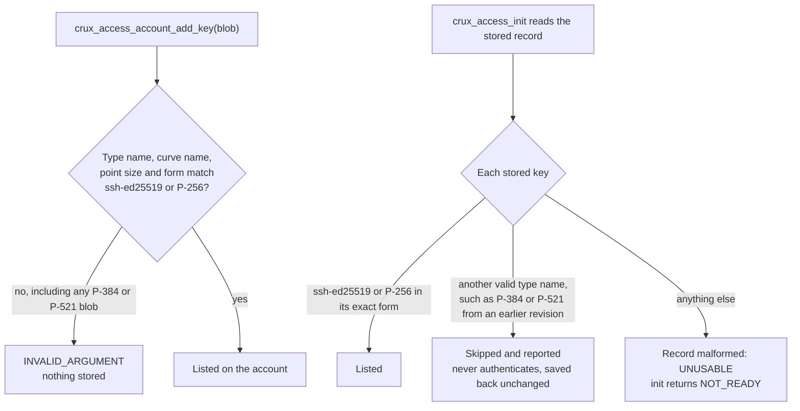

# Access control contract

Status: merged in [PR #210](https://github.com/wonny-labs/crux-pilot/pull/210) for Issue #177, on Host with fake providers, and gate #183 has passed. It runs on `native_sim` with real PSA ports in [the management composition](native-management-composition.md), and over HTTPS and SSH in [the services image](native-composition-242.md) and [the integrated image](ssh-integrated-image.md). The decisions and reasoning are in
[the accepted proposal](plans/access-contract-proposal.md), which this document does not repeat. The requests that
other contracts made of this one, AC1 and AC3 to AC10 in the secure management gate record, are accepted and
included. AC2 is declined. Where they change the proposal's text, such as its `source` comment and its wording about
a failed save and a blank medium, this document and the headers hold.

Owner: `components/access`. Public header `<crux/access.h>`, usage target `crux::access`. Adapter header
`crux_access_adapter.h`, internal target `crux_access_adapter`.

## What exists

| Item | State |
| --- | --- |
| Public and adapter contracts | Implemented as proposed, with the additions below and the accepted requests |
| Portable core | Builds on Host. `crux::access` links no port provider. The root build defines targets for the clock (the object target `crux_access_time_clock`), the store (the static library `crux_credential_access_store`) and the events (the object target `crux_security_event_access_port`) when those components are built, and none for derivation, random and keyed hash, because it has no PSA. A composition links them and lists the PSA sources, and an image without them does not link, as the [`native_sim` composition](native-management-composition.md) shows. No product composition exists yet. |
| Fake ports | Test composition in `tests/access`. They exist only when Crux builds its own tests. |
| PSA derivation, random and keyed hash | `components/access/ports/psa`, which a composition selects. The root build has no PSA. [Results](native-management-composition.md#provider-results) on both providers. |
| Clock on the Time contract | `crux_access_time_clock`. A clock that fails, or reads negative, returns `CRUX_ACCESS_CLOCK_FAILED`. |
| Credential store | Merged in #235 for Issue #178, with `crux_credential_access_store` as this contract's store port. Its [own suite](credential-store.md#tests) runs this core on it for A6, and these suites still use a fake store. |
| Event identifiers and Logging output | In the [Security event contract](security-event-contract.md), Issue #182, whose provider implements the event port. Access's own Host tests keep their recording fake. |
| Zephyr composition | [On `native_sim`](native-management-composition.md), for tests |
| Target measurements | Not implemented. Target work needs separate hardware approval. |

Host tests show contract behaviour. They do not establish entropy quality, storage confidentiality or timing on
the target. The verifier iteration count, `CRUX_ACCESS_VERIFIER_ITERATIONS`, is an unmeasured placeholder, and is not
a claim of meeting general PBKDF2 guidance.

## Choices the proposal left open

The proposal sets the direction and most of the detail. These points needed a choice to implement it. Each is
open to review, and a changed choice is small while nothing depends on it.

### Interface

| Point | Choice | Reason |
| --- | --- | --- |
| Account operation signatures | `crux_access_account_{list,create,remove,disable,enable,set_role,reset_password,change_password,add_key,remove_key}` in the public header | The proposal names the operations and their session and name arguments only |
| Changing one's own password | Takes the session and no name, because the account is the session's | A name could only disagree with the session |
| Listing more accounts than fit | Fills the buffer, and returns `OK` with the total count | The caller can size a buffer by passing zero capacity |
| Name and permission sizes | `CRUX_ACCESS_NAME_SIZE` is 32 for users and roles, and `CRUX_ACCESS_PERMISSION_MAX` is 63 | The proposal bounds user names only, and requires rejecting an over-long name |
| Public key size and type | `CRUX_ACCESS_KEY_SIZE_MAX`, default 192 bytes. A key is an SSH public key blob of type `ssh-ed25519` or `ecdsa-sha2-nistp256`, the two user key types that the SSH provider offers. Any other type or form, ECDSA on P-384 and P-521 included, is `INVALID_ARGUMENT`. A stored key of another type is skipped, not malformed ([stored keys of an unsupported type](#stored-keys-of-an-unsupported-type)). | The owner's decision on [Issue #316](https://github.com/wonny-labs/crux-pilot/issues/316), 2026-11-14, option A: Access accepts only what SSH offers, so that an account never holds a key that no login can use. The size holds the largest accepted blob, P-256, at 104 bytes, and its default stays 192 for the reason given in [User key types](#user-key-types-issue-316). Size alone would not refuse a small RSA key, or a P-384 or P-521 blob, which fit. The core checks the blob's form, and the provider checks the key itself when it verifies a signature. |
| Querying a permission without a denial | `crux_access_permitted` answers as `crux_access_check` does, and false during a forced change. It emits no event, refreshes no timer, touches no storage and changes no state, so an expired session stays for the next operation to end and report. | AC1. Hiding items through a check would emit a denial per hidden item. |
| Where a session came from | `crux_access_session_origin` copies the channel, source and source length, with unused source bytes zero. The channel is 1 for serial, 2 for web and 3 for SSH. It has the same lack of side effects as `crux_access_permitted`. | AC4 and AC7. A service holds only a session, and its records carry a channel and source. The adapter's channel type is not reachable from the public header, so the values are stated. |
| Result of a repeated `crux_access_init` | `CRUX_ACCESS_ERR_ALREADY_EXISTS`, and nothing changes | Changing a policy under live sessions has no safe meaning |
| `crux_access_check` during a forced change | Denies `access.self` too, and the account service authorises the change itself | AC5. "Every other check is denied". The change and logout operations do not go through a check. |
| Name no account can hold, at login | `INVALID_ARGUMENT`, with no work and no delay state, and an event that names nobody | It reveals nothing, because no account can have it. The rule is public. |
| Argument and session order in an account operation | Malformed arguments are refused before the session is checked, as `INVALID_ARGUMENT` whatever the session. The event names the actor only if the session is live. | The result does not depend on the session, and a malformed argument reveals nothing. |
| Invalid policy at `crux_access_init` | `INVALID_ARGUMENT`, and later operations return `NOT_READY` | The proposal lists an invalid policy under `NOT_READY`, and says init "rejects" it. The caller can tell a bad policy from a bad store. |
| Disabling a disabled account, enabling an enabled one, or setting the current role | `OK`, with no save, no event and no session ended | Nothing changed |

### Failure results

| Point | Choice | Reason |
| --- | --- | --- |
| `UNUSABLE` store | `crux_access_init` returns `NOT_READY`, as do logins and other operations, but provisioning returns `DENIED` | The result list says `NOT_READY` for an unusable store, and the provisioning rule says `DENIED` |
| What `EMPTY` means | A started store holds no account record, because device keys can exist first. A blank or reformatted medium reads as `EMPTY` only if the store can start on it. A blank card on the microSD composition fails at mount and reads `UNUSABLE`. | AC6. Limit A7 stands, and widens under the credential store's S6. |
| What a failed save promises | RAM is unchanged, and so is the active image except under the credential store's S7. Stored bytes can change, and a failed save can win at the next boot if the store cannot then invalidate it. | AC8 |
| Retrying init after `UNUSABLE` | Refused without reading the store again | Otherwise a blank medium inserted while running would read as `EMPTY`, which the proposal forbids |
| A record the store calls `VALID` that cannot be decoded | Treated as `UNUSABLE` | Fail closed, including an unknown verifier algorithm or a zero iteration count. A well-formed user key of an unsupported type is not a decoding failure: it is [skipped](#stored-keys-of-an-unsupported-type). |
| Random, keyed hash or derivation failure | `NOT_READY`, counted as no failure | No guess was evaluated. **This widens `NOT_READY`, whose proposed comment lists only three causes.** |
| Password over 128 bytes at login | `DENIED`, counted as no failure, with a login failure event that names nobody | "Denied without verification". No guess was evaluated. |
| Setting a password over 128 bytes | Always `PASSWORD_REJECTED`, whatever the product rule says | Login denies it, so such an account could never log in |
| `NO_RESOURCES` | Also covers a full key table | It is the same kind of limit |

### Sequencing

| Point | Choice | Reason |
| --- | --- | --- |
| Second delay check at step 3 | Steps 2 and 3 share one lock hold | Claiming the slot never waits, so nothing can change between them |
| Clock | Read under the state lock | Stored times are then in order, so an elapsed time cannot wrap and clear a bucket or expire a live session. This is a new requirement on the provider: the clock must not wait. |
| Clock running backwards | Expires sessions, and never clears a bucket | Fails closed. A monotonic port never does this. |
| Clock that fails | `crux_access_port_now_ms` returns `CRUX_ACCESS_CLOCK_FAILED` (`UINT64_MAX`, which no monotonic millisecond count reaches). A password login, a password change's verification, a key pre-check and a provider-verified login return `NOT_READY` with a not-ready event, create no session and leave every bucket unchanged, also when the clock fails after the derivation. A failed signature reported then counts nothing. A session from before the fault is ended by the next call that looks it up for use (a check, a touch, a name query, a logout or an account operation). A read-only query such as `crux_access_permitted` or `crux_access_session_origin` answers `SESSION_INVALID` during the fault and leaves the session in place. | Fails closed. No time means no session can be dated and no delay can be measured, so nothing that needs one proceeds. `tests/access/clock_fault.c` holds this. See [the composition's port choices](native-management-composition.md#what-each-port-maps). |
| Serial bucket after a success | Not cleared | "Success clears the name bucket only", and serial has no name bucket. A user who mistypes keeps counting until the quiet period. |
| Serial when slot 0 is taken | May use any free slot | Slot 0 is reserved against the network, not a limit on serial |
| Own password change | Rule first, then the delay, then the verification slot for the current password only. A new verifier takes no slot, in this or any other operation. | The rule result never confirms the current password, and a login flood cannot block an administrator's reset. |
| Any change to the account during an own password change | `DENIED`, because the verification no longer applies, or `SESSION_INVALID` if the change ended the session | The same rule as login |
| Key pre-check on an account that cannot log in by key | Lists no keys, so a signed request counts as a key failure | Unknown, disabled, forced-change and role-less accounts cannot be told apart. `crux_access_login_verified` still refuses them, for a change after the pre-check. |
| Failed signature reported inside a window | Leaves an event and neither counts nor extends | "An attempt inside a window" applies |
| Unsigned probe inside a window | `RETRY_LATER`, with no event | "An unsigned probe records nothing" |
| Successful current password in an own password change | Clears the name bucket | "Follows the login delay", and "success clears the name bucket" |

### Providers and events

| Point | Choice | Reason |
| --- | --- | --- |
| Locks | The core uses `crux::sync`, and the ports do not include a lock | Reuses an existing capability, as `AGENTS.md` asks. `CRUX_BUILD_ACCESS` requires `CRUX_BUILD_SYNC`. |
| Derive port | Derives only, and the core compares | The proposal's port table says "derive and compare". Step 6 of the login sequence needs the comparison and the clearing in one place, for every provider. |
| Store port | Takes and returns bytes, and the core owns the versioned encoding | Each provider would otherwise repeat it. Issue #178 owns atomic replacement and corruption detection. |
| Change numbers | RAM only | They detect a change racing a login, and a reset ends every login |
| Stack | The pending table and record buffer are static, guarded by the change lock | A full table is about 4 KB, and a management worker's stack should not have to hold it |
| `delay applied` event | Emitted when an attempt is rejected, naming nobody | A rejected attempt was not looked up, and its name may be a mistyped password |
| When events run | After both locks are released, on every path. They can arrive before a successful init. | AC9. An emit may wait on the event ring, and every check takes the state lock. Tests poll both locks inside the event port. |
| Event fields | `actor` is the acting session's user, and empty when no session acted. `account` is a login's account, a change's target, or the account of a stored key skipped at init. `permission` is set on a denial. Each name is a known account's, or the field is empty. | AC10. `actor` and `account` are the same when an account changes its own password. |
| No event, by design | A session ended by the per-account cap, a cost upgrade including one whose save fails, an operation that changed nothing, a lost lock, an unsigned key probe unless it is refused as `NOT_READY`, a logout of a reference already ended, and a malformed argument to a check or session query | Nothing was rejected, or the call came from a context where the port cannot run, or it is a caller's programming error. An unsigned probe records nothing, as the proposal says. |

The accepted request AC3 adds rejection events. The identifiers are final in the
[Security event contract](security-event-contract.md), which also lists each port event's fields and result.

| Port event | Identifier | When |
| --- | --- | --- |
| `LOGIN_FAILURE` | `access.login_failed` | Wrong password, unknown name, disabled account, bad name form or password over 128 bytes |
| `KEY_FAILURE` | `access.key_failed` | A signed request with an unlisted key, or a failed signature. Also a [stored key skipped](#stored-keys-of-an-unsupported-type) at init, with no channel and `INVALID_ARGUMENT`. |
| `DELAY_APPLIED` | `access.delayed` | Inside a delay window, on any operation that is delayed |
| `LOGIN_BUSY` | `access.login_busy` | The channel's verification slot is taken, including for an own password change |
| `LOGIN_NO_SESSION` | `access.login_no_session` | The session table is full |
| `LOGIN_REFUSED` | `access.login_refused` | A removed role, a signed key attempt on an account under a forced change, or `crux_access_login_verified` refused. The client's result is unchanged. |
| `NOT_READY` | `access.not_ready` | Not initialised, an unusable store, or a provider failure |
| `PERMISSION_DENIED` | `access.permission_denied` | A check or account operation without the permission |
| `SESSION_INVALID` | `access.session_invalid` | A session never valid or already ended, with no channel |
| `SESSION_EXPIRED` | `access.session_expired` | A session found expired on use, or reclaimed |
| `PROVISION_REFUSED` | `access.provision_refused` | Any refused provisioning. A failed save is `CHANGE_FAILED`. |
| `CHANGE_FAILED` | `access.change_failed` | A save failed. Names the target only if it already exists. |
| `CHANGE_REJECTED` | `access.change_rejected` | An account operation refused for its arguments or state, or a wrong current password. Names the target only if it is known to exist. |

## User key types (Issue #316)

Decided 2026-11-14, option A of [Issue #316](https://github.com/wonny-labs/crux-pilot/issues/316): `crux_access_account_add_key` accepts only the user key types that the SSH provider offers. Before this change it also accepted ECDSA on P-384 and P-521, so an account could hold a key that SSH never accepts, stored with no sign to the person who added it.

**Stability.** `crux_access_account_add_key` is in `<crux/access.h>`, whose `Status:` line reads Experimental (ADR-0001 decision 4), and [the readiness table](component-readiness.md) gives Access the same provisional tier: it has no Zephyr composition outside `tests/`. An Experimental interface may change in any release, listed in the release notes, so this narrowing is not a breaking change under the policy. No release or tag exists yet. The change is listed here and in the pull request.

| Key type | `crux_access_account_add_key` | SSH provider (`WOLF_USER_KEY_LIST`) |
| --- | --- | --- |
| `ssh-ed25519`, 32-byte point | Accepted | Offered |
| `ecdsa-sha2-nistp256`, `nistp256`, 65-byte uncompressed point | Accepted | Offered |
| `ecdsa-sha2-nistp384`, `ecdsa-sha2-nistp521` | **`INVALID_ARGUMENT` since #316**, was accepted | Refused before any callback |
| RSA, DSA, Ed448, certificates, security keys | `INVALID_ARGUMENT`, unchanged | Refused before any callback |

**Which profile can verify which type.** Access never verifies a key signature. It compares the blob byte for byte (`crux_access_key_is_authorised`), and its PSA ports (`components/access/ports/psa/access_psa.c`) hold only derivation, random and HMAC, so the choice of TLS/PSA profile does not change what `crux_access_account_add_key` accepts. The signature is verified by the SSH provider, which exists on the Wolf profile only.

| Profile | SSH provider | `ssh-ed25519` user key | `ecdsa-sha2-nistp256` user key | What the documents and code show |
| --- | --- | --- | --- | --- |
| Wolf (wolfSSL, wolfSSH, wolfPSA) | Yes | Verified by wolfSSH, built with `CONFIG_WOLFSSL_CURVE25519` and `WOLFSSL_ED25519_STREAMING_VERIFY` | Verified by wolfSSH | [`wolf_ssh_settings.cmake`](../components/ssh/ports/zephyr/wolf_ssh_settings.cmake), [`wolf-ssh.conf`](../components/ssh/ports/zephyr/wolf-ssh.conf). The Zephyr conformance client fails to compile unless Ed25519 and P-256 are present and P-384 and P-521 are absent (`tests/zephyr/ssh_provider/src/conformance_client.c`). Key logins ran on `native_sim` ([provider record](ssh-wolf-provider.md#results)). |
| Mbed (Mbed TLS, TF-PSA-Crypto) | **No.** [A build that enables CLI or SFTP with it fails at configuration time.](plans/secure-management-design.md#provider-profiles) | No SSH to verify with. TF-PSA-Crypto also declares Ed25519 unsupported ([qualification](psa-crypto-qualification.md)), which concerns the credential store's key generation, not user key verification | No SSH to verify with. TF-PSA-Crypto supports P-256 | No Access path verifies a key on this profile. A stored user key is inert there, whatever its type. |

So the accepted set is the SSH provider's set, not a per-profile set. Access does not ask a provider which types it can verify: that would be a new port in `access_port.h`, and nothing in this change needs one. On an image without SSH, such as the Mbed profile, the added key is stored and no login can use it. That is the same situation as before for a key of any type, and this change does not address it. It is listed as a decision for review below.

**The size bound.** `CRUX_ACCESS_KEY_SIZE_MAX` stays 192. The largest accepted blob is now P-256 at 104 bytes, so the bound has room to spare, and the build refuses a value below 104. Lowering it is not needed for this change. A record can also hold [skipped keys](#stored-keys-of-an-unsupported-type), such as a P-384 key (136 bytes) or a P-521 key (172 bytes) from an earlier revision, and a stored key longer than the bound makes the record malformed. A lower bound would therefore lock out every account on a store that holds one. It would also change `CRUX_ACCESS_RECORD_SIZE_MAX` (4,060 bytes at the default bounds, see the [credential store](credential-store.md) limits table) and the RAM of every account, and a product that sets the macro is unaffected by the default. A lower default is left to a separate change.

### Stored keys of an unsupported type

A stored user key of a type this build does not support is skipped, and the store stays usable.

**Where the boundary lies.** The record frames each key with its own length, so a key's content cannot shift the fields after it. Inside that frame, an SSH public key blob is a type name string followed by data whose form the type defines ([RFC 4253 section 6.6](https://www.rfc-editor.org/rfc/rfc4253#section-6.6)). The decoder sorts each stored key into one of three cases:

| Stored key | Result |
| --- | --- |
| Type name `ssh-ed25519` or `ecdsa-sha2-nistp256`, in exactly the form `crux_access_account_add_key` accepts | Listed |
| A type string that fits in the key, holding a valid SSH name ([RFC 4251 section 6](https://www.rfc-editor.org/rfc/rfc4251#section-6): 1 to 64 printable US-ASCII characters, no comma; the placement of `@` is not checked) that is not one of those two | **Skipped.** The data after the name is not examined. |
| Anything else: a key length of zero or over `CRUX_ACCESS_KEY_SIZE_MAX`, fewer than 4 bytes, a type string longer than the key, an empty or invalid name, or a supported name in any other form, such as a P-256 key with a compressed point | Malformed: the store is `UNUSABLE`, as before |

Every other field keeps the fail-closed rule: truncation, trailing bytes, the header, names, flags, the verifier, a key count over the bound and duplicate names. Detecting a changed byte is the store's integrity check. A flipped bit that leaves a valid name of another type, in a record the store still reports as `VALID`, is skipped like any unsupported type, which can only narrow access.

**What a skipped key does.**

| What | Result | Test (`tests/access/faults.c`) |
| --- | --- | --- |
| `crux_access_init` | `OK`. Every other account and key works. | `unsupported_key_tolerated_cases` |
| Report | One `KEY_FAILURE` event (`access.key_failed`) per skipped key during `crux_access_init`, naming its account, with no channel and the result `INVALID_ARGUMENT` (event result `invalid`). A client's key failure always has a channel and the result `DENIED`. No new event kind or public interface. | The same |
| Authentication | Never. The pre-check and `crux_access_login_verified` do not list it, even if a provider offers the identical blob. | The same |
| Saving the table | Every save writes it back byte for byte, so a build that supports the type can use it again | `unsupported_key_write_back_cases` |
| `crux_access_account_list` | Counted in `key_count` | The same |
| Key table | It holds a slot, so an account can be full | The same |
| Removing it | `crux_access_account_remove_key` with its exact bytes, which narrows access | The same |
| Adding it again | `INVALID_ARGUMENT`, as for any unsupported type | `tests/access/keys.c` |

The record version stays 1: a record that holds a skipped key is still a valid version 1 record, and an earlier revision reads it as it did before.

### Decisions for review (Issue #316)

| # | Decision taken for lack of an answer | Recommendation | Impact if the owner decides otherwise |
| --- | --- | --- | --- |
| 1 | A stored P-384 or P-521 key | Decided 2026-11-26: [skipped and kept](#stored-keys-of-an-unsupported-type) | |
| 2 | `CRUX_ACCESS_KEY_SIZE_MAX` stays 192 | Keep. A default below 172 bytes would make a store holding a skipped P-521 key unusable, although it would lower `CRUX_ACCESS_RECORD_SIZE_MAX` and per-account RAM | A separate change to the default, with the RAM saving measured and old stores considered |
| 3 | Access does not depend on the profile: Ed25519 and P-256 blobs are accepted on the Mbed profile too, where no SSH provider exists to use them | Keep. A capability port would be a new private interface for no consumer | A provider declaration read by `crux_access_key_acceptable` |

## Declared limits

- A lock that cannot be taken means misuse, such as a call outside thread context. It produces no event. Operations
  fail closed, with these effects until a reset. After a failed lock at the end of a verification, that channel stays
  `BUSY`, and a login's reserved session slot stays taken. After a failed lock between a save and applying it, the
  medium holds a newer table than RAM. For the first account, provisioning closes before the save and reopens only
  after a save that failed. A lock lost after it closes leaves it closed, so a retry cannot replace what the medium
  holds. A lock lost before it closes saved nothing, leaves it open, and can be retried. For other changes, RAM still
  holds the old table, so a change such as disabling an account has not taken effect until the reset. Tests cover a
  lock that fails from the first call of an operation, a reset that loses its second lock, and the provisioning cases,
  not the other effects.
- The record's integrity across power loss is the store's. The core checks the shape of what it is told is valid.
- The `host-sanitize` preset is ASan and UBSan, which do not detect data races. See the pull request for a separate
  ThreadSanitizer run and its limits.

## Bounds

Compile-time defaults in `components/access/src/access_port.h`, each overridable:

| Macro | Default |
| --- | --- |
| `CRUX_ACCESS_SESSION_MAX` | 8, with slot 0 reserved for serial |
| `CRUX_ACCESS_SESSIONS_PER_ACCOUNT` | 3 |
| `CRUX_ACCESS_ACCOUNT_MAX` | 8 |
| `CRUX_ACCESS_KEYS_PER_ACCOUNT` | 2 |
| `CRUX_ACCESS_KEY_SIZE_MAX` | 192 |
| `CRUX_ACCESS_SOURCE_BUCKETS`, `CRUX_ACCESS_NAME_BUCKETS` | 32 each |
| `CRUX_ACCESS_DELAY_FREE_ATTEMPTS` | 5 |
| `CRUX_ACCESS_DELAY_BASE_MS`, `CRUX_ACCESS_DELAY_CAP_MS` | 1,000 and 60,000 |
| `CRUX_ACCESS_DELAY_QUIET_MS` | 900,000 |
| `CRUX_ACCESS_VERIFIER_ITERATIONS` | 10,000, an unmeasured placeholder |

## Boundary

`crux_access_core` links `crux_access_adapter` and its own `src` directory `PRIVATE`, so CMake records the adapter
target as `$<LINK_ONLY:crux_access_adapter>` and neither directory reaches a consumer of `crux::access`.
`cmake/CruxAccessBoundary.cmake` adds the rule the proposal asked for: it follows the include directories and `-I`
options a target exposes, and ignores `LINK_ONLY`, because that is what a consumer's compilation can see. A target
such as `crux::web` can therefore link `crux_access_adapter` privately. The rule rejects the adapter directory, a
directory below it, and a parent from which the header resolves by a longer path. The root build applies it to every
public target, and a designated consumer can call it. It cannot see a target that nothing asks it to check, a `-I`
option given as two separate tokens, or a relative path. Each of those is a project's deliberate choice, which the
rule is not meant to stop.
`scripts/check-access-boundary.py` tests it in both directions.

The test composition cannot be selected by any provider setting. A build that sets `CRUX_BUILD_TESTS=ON` creates the
target `crux_access_test_composition`, which a superproject could still link by name, so it must not use that build
for a product image.

## Tests

`scripts/test-access.sh` runs the suites under the `host-debug` and `host-sanitize` presets, clang-tidy on the
Access sources, and the boundary check. The root build also runs the suites as `Access.*` under
`scripts/check-host.sh`.

| Suite | Covers |
| --- | --- |
| `tests/access/conformance.c` | Two different policies: permitted, unauthenticated, unpermitted, expired, stale, reused slot, generation wrap, invalid policy, provisioning, the permission and origin queries |
| `tests/access/accounts.c` | Each operation, session ending rules, forced change, last administrator including concurrent changes, save failure, power loss, a login during a save, a check that does not wait on a save or derivation |
| `tests/access/security.c` | Equal treatment of unknown and disabled names, table-filling probe, delay rules, guessing bound, collisions, flooding, serial independence, verification slots, races with a login, cost upgrade |
| `tests/access/keys.c` | Key types (Ed25519 and P-256 accepted, P-384 and P-521 refused as `INVALID_ARGUMENT` although they fit the size bound) and malformed blobs, signed and unsigned attempts, failed signatures, provider-verified login |
| `tests/access/faults.c` | Session exhaustion and reclaim, store states, every truncation of a record and a chosen set of field corruptions, stored keys of unsupported types (skipped, reported, saved back) and the boundary to malformed keys, 64-bit time, provider failures, lock failure including around the first account's save, concurrent logins |
| `tests/access/secrets.c` | Known password and key values absent from every event type, and no plain password on the medium |
| `tests/access/events.c` | Each rejection path produces its event with its fields, every event runs with no lock held, and the two silent queries emit nothing |
