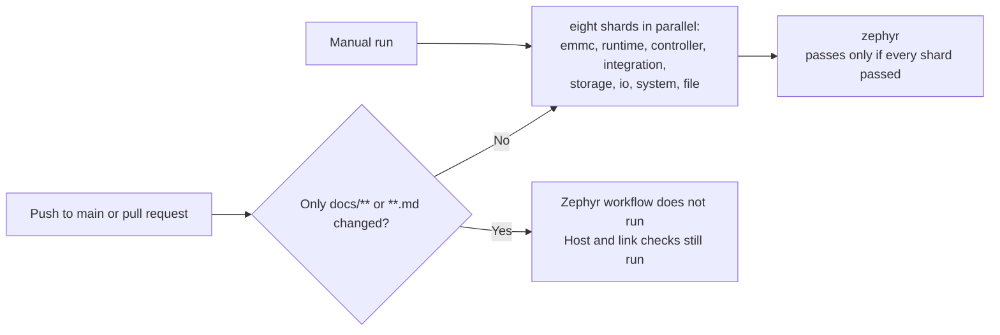

# Zephyr CI shards

The Zephyr checks run in eight parallel jobs, called shards: the `zephyr-*` jobs of [`scripts/ci/checks.toml`](../scripts/ci/checks.toml). The [`zephyr-software` workflow](../.github/workflows/zephyr.yml) and the root `Jenkinsfile` run one shard per job. This page explains how they are arranged, where to put a check, and what was measured when the layout was chosen. [Continuous integration](ci.md) says which tier runs which check, and [ADR-0009](decisions/0009-tiered-ci.md#t10-shortening-the-tiers) why the jobs are split this way.

## Layout

Each shard is a separate runner with its own checkout, Zephyr workspace and SDK. Shards share nothing, and each uploads its own artifact, named `zephyr-<shard>-<run>-<attempt>`. A failing shard does not cancel the others, so one run reports every failing area. Within a shard, the first failing check stops the checks after it. A shard whose tier selects no check skips its set-up and passes. The matrix lists the longest shards first, so that they start first when runners are short.

## Shards

The shards were balanced by the measured time of each check. Times are whole jobs, set-up included, from two full runs on `ubuntu-24.04` runners at `07334939` and `a704189d`.

| Shard | Checks | Minutes |
| --- | --- | --- |
| `emmc` | eMMC stack, power-cut replay and Reliance Edge on `native_sim` | 10.2, 9.7 |
| `storage` | Patch style, storage simulators, Flash PoC fault paths, Time and EVKB build | 10.0, 8.8 |
| `file` | File RT1060 compile, File eMMC link check | 9.5, 8.1 |
| `controller` | Smoke builds, execution candidates, early controller, RT1170 cross-build, M5 integrated smoke, product template, networking, networking physical fixture | 13.8, 12.0 |
| `integration` | Controller integration, reboot sanitizers, Time busy-wait | 12.8, 10.3 |
| `runtime` | Portable execution, messaging, Logging, boot composition | 13.6, 9.8 |
| `system` | Out-of-tree consumer, System, Serial | 13.3, 9.6 |
| `io` | Command line shell rule and SSH entry points, GPIO, I2C, SPI, web adapter | 10.2, 10.3 |

Set-up (packages, tools, SDK and workspace) adds 2.4 to 2.7 minutes to every shard, and the upload 0.1 minutes.

`scripts/test-networking-physical.sh` reads the Picolibc checkout that `scripts/bootstrap-networking-tests.sh` fetches, so these two must stay in the same shard. A check that enables an optional west group (`emmc-reliance-edge` and `file-emmc-compile` enable `crux-reliance`, `boot-composition` enables `crux-boot`) must be the last of its shard. No other check reads what another check produces; each shard passing on a fresh runner shows it.

## Add a check

Follow [Add a check](ci.md#add-a-check), with the job `zephyr-<shard>`:

1. Prefer the shard whose work is closest, unless that would make it clearly the longest. A check of more than about seven minutes, or one that would take a shard past about ten, goes to the shortest shard or a new one.
2. Put a check that reads another check's output in the same shard, after it.
3. Add any new output paths to the upload step of `zephyr.yml`.

`tests/build/test_zephyr_ci_shards.py` runs in Host CI. It fails in these cases:

| Defect | Why it matters |
| --- | --- |
| A step that runs a command is neither a set-up step nor `scripts/ci/run-tier.sh` for the shard's job | The check would run outside the tiers, in every shard |
| The matrix and the `zephyr-*` jobs of the map file differ | A job's checks would never run while the run stays green |
| A Zephyr check has a scope other than `not-docs`, or `not-docs` differs from the workflow's filter | Its documentation rule would differ on other CI systems |
| The networking checks are in different shards | The fixture check would not find its library |
| Two shards could share an artifact name | The upload would be refused |
| The summary job accepts anything but `success` | A cancelled or skipped shard would look like a pass |
| Anything other than documentation skips the workflow | Code changes would go untested |
| `host.yml` gets a `paths-ignore` filter | Nothing would run the tests that read documentation |
| A tier workflow lacks `ready_for_review`, the nightly schedule or the manual tier input | A ready pull request or the nightly run would miss the full set |
| A workflow job with a matrix of map file jobs names a fixed job | One job would run in every entry while the others never run |

`tests/build/test_ci_tiers.py` holds the checks of every job with their commands, so a deleted or changed check fails it, and it requires a check that enables an optional west group to be the last of its job. The shard test cannot tell that a set-up step is still only a set-up step: the steps in `SET_UP_STEPS` (set-up and evidence collection) are exempt by title, and are rejected if they mention `scripts/`, `python3 ` or `west `, unless the step runs `scripts/bootstrap-zephyr.sh` or `scripts/verify-apt-cache.py`, in which case it is exempt whatever else it runs. Add a step to `SET_UP_STEPS` only if it must run in every shard.

## Documentation-only changes

The workflow does not run when every changed file matches `docs/**` or `**.md`, and the map file gives every Zephyr check the same rule on other CI systems. A pull request that also changes code still runs it. `tests/build/test_product_template.py` is the only Zephyr-side check found to read documentation, and the `host-build-tests` job also runs it: `host.yml` has no such filter, and the tests in `tests/build` run for every change.

`psa-crypto.yml` skips documentation too, except a change to a dependency review record, which its pin check reads.

If `zephyr` becomes a required check, a documentation-only pull request would wait for a check that never reports. `main` has no required checks today, so this needs handling before such a rule is added.

## Measurements

All runs used GitHub-hosted `ubuntu-24.04` runners. Times are in minutes.

| Layout | Slowest shard | Zephyr workflow, creation to end |
| --- | --- | ---: |
| Four shards, at `be60bc65` | `storage` 30.5, of which `emmc-reliance-edge` 12.4 | 31.3 |
| Eight shards, at `a704189d` | `controller` 12.0 | 14.1 |

`emmc-reliance-edge` took 9.2 to 14.8 minutes in three four-shard runs, which alone set the old `storage` shard's length. As a check of its own shard, its storage half took 7.3 and 7.6 minutes.

Package downloads once set the length of slow runs. In two four-shard runs the `io` job spent 4.8 and 7.7 minutes installing packages, against about 0.3 minutes normally. Across 32 shard jobs in 8 measured runs, 5 spent 3.5 to 10.3 minutes in that step, and those 5 lengthened 4 of the 8 runs. All five were `.deb` downloads from the archive mirror. [PR #261](https://github.com/wonny-labs/crux-pilot/pull/261) then added a cache for them. Each shard restores the packages, `scripts/verify-apt-cache.py` removes every file whose SHA-256 differs from the signed index, and apt downloads whatever is missing. In the hosted runs after that change the install step took 0.1 to 0.3 minutes in every job and downloaded nothing. A typical run was not shorter (16.2 to 17.6 minutes against 14.1 to 16.4 in runs without a slow download), so the gain is that a run no longer waits on the mirror.

Another stall seen once: the `io` job took 6.2 minutes to fetch the Zephyr workspace in a `-j 4` run.

## Options measured and not adopted

| Option | Run 1 | Run 2 | Finding |
| --- | ---: | ---: | --- |
| Twister `-j 4` instead of `-j 2` | 22.1 | 23.9 | No clear gain. Both runs were lengthened by package downloads (9.6 and 10.3 minutes). The longest shard's checks took 11.6 and 13.4 minutes, against 13.1 to 14.1 with `-j 2`. |
| ccache, both runs cold | 16.4 | 14.1 | Both started empty, because `actions/cache` rejected a path containing `..`. This pair says nothing about re-use. |

A later pair with a working cache, on identical source, gave the second run 99.2% (`storage`), 99.6% (`controller`), 84.7% (`runtime`) and 99.7% (`io`) hits. Its check steps summed to 41.4 minutes. Seven runs without ccache summed to 40.7 to 53.2 minutes. Only 34% to 54% of compiler calls are cacheable, and configuring, linking and running tests do not benefit. This is one warm run and runs on identical source differ by up to 8.9 minutes, so it shows no benefit but does not prove there is none. It was not adopted because it adds a cache and its upkeep for no measured gain.

## Limits

- Total runner time rises because each shard repeats the set-up.
- Each run uses nine jobs (eight shards and the summary). A full run of a code change uses 15 jobs across the workflows, 19 with the web jobs, and GitHub's free plan runs at most 20 at once ([limits](https://docs.github.com/en/actions/reference/limits)), so two runs at once queue some shards. In the first trial the `emmc` shard waited while another pull request's run held runners.
- The shard sizes come from past timings and will drift. Rebalance them when one shard stays clearly the longest.
