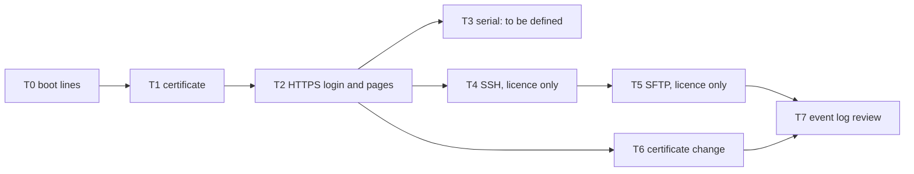

# Secure management: bench test procedure

> **Historical record.** Moved to `docs/history/` from `docs/` when the documentation was restructured as a developer entry point. It is kept as written; it is not current guidance, and the link check does not read it.

Status: **not yet run with this procedure.** No step below has been executed on a board by anyone, and no management image has run on a board ([review guide](../secure-management-review.md#what-is-verified-and-where)). This procedure is for a team's own bench. It approves no board operation, and nothing in this repository approves one for that bench. It contains no credential.

Every command and expected output below is taken from an existing document, test or source, cited in each step. A step marked **derived** changes one documented command in one stated way, and its expected result comes from the cited rule. A step marked **to be defined** has no source in this repository, and the reason is given. The security model behind the checks is in the [review guide](../secure-management-review.md).

## Before you start: what exists and what does not

| Question | Answer | Source |
| --- | --- | --- |
| Is there an image to program? | Two, neither run. (1) The RT1060-EVKB **bench image**, `tests/zephyr/management_rt1060_compile`, which **refuses to start**: `CRUX_BENCH_RUN_REFUSED` is `ON` in its `CMakeLists.txt`, and lifting it is a code change that your team must review and own. (2) The **Mbed management image**, `samples/management_rt1060_mbed`, HTTPS only and meant to run, which `psa-crypto.yml` cross-builds, without flashing, on each pull request and push to `main`; the step passed on `main` at `164b0428`: see [using the Mbed image](#using-the-mbed-image). The checks below are written for the bench image. | [Bench plan, B3](../rt1060-bench-image-plan.md#what-blocks-the-plan-today), `src/main.c`, [Mbed management image](../rt1060-mbed-management-image.md) |
| Is it a product image? | **No.** It has four declared bench test forms: a test host key form, no time source, a RAM disk (nothing persists across a reset), and a first-account password embedded in Flash from a file. | [Bench plan](../rt1060-bench-image-plan.md#d-the-expected-boot-banner-and-the-lines-in-order), [bench first account](../rt1060-bench-first-account.md) |
| Which TLS profile? | The bench image: **Wolf** (wolfSSL, wolfSSH, wolfPSA), for HTTPS too. The Mbed image: Mbed TLS with TF-PSA-Crypto, no SSH. | `CMakeLists.txt` (`tls_offload_probe/wolf.conf`), [Mbed management image](../rt1060-mbed-management-image.md) |
| Licence | wolfSSL and wolfSSH are GPL-3.0-or-later or commercial, wolfPSA's source states GPL-3.0-or-later, and the TLS socket patch has unconfirmed terms. **Building the bench image at all needs the Wolf stack**; the Mbed image uses none of it. Decide your licence position before any step; this procedure decides none. | [Patches README](../../patches/zephyr/README.md#wolfssl-tls-socket-backend) |
| Serial command line | **Composed in no image.** The bench image's UART is a log output only (`CONFIG_CONSOLE_HANDLER=n`, `CONFIG_SHELL=n` in `target.conf`). | [CLI contract](../cli-contract.md#what-exists) |
| A route to read events | **None.** `GET /api/v1/events` is not built. Events appear as Logging lines on the console UART, and as counts in `GET /api/v1/status`. | [Security event contract](../security-event-contract.md#what-exists), `target.conf` |
| A way to replace the certificate | **None**: no route and no command. | [TLS certificate](../tls-certificate.md#replacing-the-certificate) |

If your team builds its own product image instead, keep the checks and replace the bench addresses, lines and test forms with your image's own. A product supplies the first account through the serial setup step (`!setup`), the certificate registration, the host key holding and the user keys ([product guide](../management-in-a-product.md#what-you-get-and-what-is-not-built)).

## Common prerequisites

| Item | Value | Source |
| --- | --- | --- |
| Board | RT1060-EVKB (revision B), `mimxrt1060_evk@B//qspi`, **no microSD card** in the slot | [Bench plan](../rt1060-bench-image-plan.md#who-does-what) |
| Link | One dedicated Ethernet link. Board `192.168.77.2/24`, host `192.168.77.1/24`, no router. Both listeners bind only `192.168.77.2`; HTTPS on 443, SSH on 22. | `bench-manifest.json` fields in the [bench plan](../rt1060-bench-image-plan.md#the-image-that-was-built), `target.conf` |
| Console | The board's console UART (LPUART1), 115,200 baud, opened **read-only** and every byte saved to a file (called `CAPTURE` below) | [Capture procedure](../rt1060-bench-image-plan.md#e-the-capture-procedure), `target.conf` |
| Host tools | `openssl`, `curl`, `ssh`, `ssh-keyscan`, `ssh-keygen`, `sftp`, `python3`; record each version (`openssl version`, `ssh -V`, `curl --version`, `python3 --version`) | [Bench plan, P7](../rt1060-bench-image-plan.md#steps) |
| Evidence folder | One new, empty folder per run, called `E` below. A private folder outside every git work tree for the password material, removed afterwards. | [Evidence to keep](../rt1060-bench-image-plan.md#evidence-to-keep) |
| First-account password | Generated by the bench mechanism, outside every repository: `python3 tests/zephyr/management_rt1060_compile/bench_first_account_file.py generate --file <path outside any repository>`. It prints a hash only. **Never** paste the password into a log, a command line or the evidence. | [How to use it](../rt1060-bench-first-account.md#how-to-use-it) |
| Build | `cmake -S tests/zephyr/management_rt1060_compile -B <build> -G Ninja -DBOARD='mimxrt1060_evk@B//qspi' "-DZEPHYR_MODULES=<the ten module paths, as listed in build.sh line 13>" -DCMAKE_EXPORT_COMPILE_COMMANDS=ON`, then `ninja -C <build>`, in a west workspace with the `crux-secure-management` group (`west config manifest.group-filter -- +crux-secure-management`, then `west update`), with the environment variable `CRUX_BENCH_PASSWORD_FILE` naming the file and `ZEPHYR_BASE` a Zephyr copy prepared by `scripts/prepare-wolf-tls-zephyr.sh COPY` and then `scripts/prepare-isn-fail-closed.py COPY` ([how the copy is made](../rt1060-isn-fail-closed.md)), after your own reviewed change that lifts the refusal | [Recorded build script](../evidence/rt1060-management-image-feasibility/image-plan-c8/commands/build.sh), [pinned set](../rt1060-bench-image-plan.md#b-the-manifest-source-and-the-pinned-set) |
| Scan after the build | `python3 tests/zephyr/management_rt1060_compile/bench_first_account_file.py scan --password-file <file> --build <build> --repo . --also <log folders> --allow-in-image --expect-in-image <build>/zephyr/zephyr.elf --manifest <build>/bench-manifest.json`, expecting exit 0 | [Bench plan, P4](../rt1060-bench-image-plan.md#steps) |
| Programming | **To be defined by your team.** The repository's programming driver (`tests/target/program_m5_image.py`) is tied to its own bench, its guard and approval documents, and the bench image profile is not registered ([B2](../rt1060-bench-image-plan.md#what-blocks-the-plan-today)). | |

**Stop rules for every check**, from the [bench plan](../rt1060-bench-image-plan.md#stop-conditions-and-the-no-retry-rule): a refusal or failure line on the console, no `BENCH ready` within 120 s, a fatal error text, an unplanned second `BENCH image=` line, or a certificate or host key fingerprint that differs from the console's. **When a fingerprint differs, send no password.**

**After every run, and after any stop once programming started**, put the board's previous image back and verify it, as the bench plan's [restoration](../rt1060-bench-image-plan.md#restoration) does for its own bench; the method is your team's.

Verdicts are **PASS**, **FAIL** or **NOT RUN**. A FAIL is a finding to report, not a reason to retry.

## Using the Mbed image

The [Mbed management image](../rt1060-mbed-management-image.md) has its own build, first account, console lines and team checks; use that document for them. How the checks below map onto it:

| Check | With the Mbed image |
| --- | --- |
| T0 | The `MBED-MGMT ...` lines of its [expected console lines](../rt1060-mbed-management-image.md#expected-console-lines) instead of the `BENCH` lines, ending with `MBED-MGMT ready https://192.168.77.2:443/` |
| First account | Only through its test form, off by default (`CONFIG_CRUX_MBED_MGMT_TEST_FIRST_ACCOUNT` with the environment variable `CRUX_MBED_MGMT_PASSWORD_FILE`), [the first account](../rt1060-mbed-management-image.md#the-first-account); without it nobody can log in |
| T1 | The certificate line is `MBED-MGMT certificate sha256=...`. Its certificate names `crux-rt1060` and the board's address, not `crux-bench`: use `-servername crux-rt1060` (or none, as its own check does) and expect `DNS:crux-rt1060` ([what it contains](../rt1060-mbed-management-image.md#what-it-contains), `samples/management_rt1060_mbed/src/composition.c`). The Mbed profile has no X25519: `-groups X25519:P-256` completes on P-256 after a HelloRetryRequest, and X25519 alone is refused ([what a team checks](../rt1060-mbed-management-image.md#what-a-team-checks)) |
| T2 | Applies as written. The routes also include reboot: `POST /api/v1/system/reboot` resets the board |
| T7 | The rows for the web login and logout, a wrong password, T2 step 5 and the certificate at first boot apply; `access.provisioned` only with the test first account on; the SSH and SFTP rows do not apply |
| T3, T4, T5 | Not available: no serial console, no SSH, no SFTP in the image |
| T6 | Its reboot route or a reset gives a new certificate, as the RAM disk makes every boot a first boot |
| Programming | The team's own: `west flash` with a runner for this board, or the NXP tools ([flash and run](../rt1060-mbed-management-image.md#flash-and-run)) |

## T0. Boot and image identity

**Purpose.** Show that the board runs the intended image, that entropy answered and that both listeners started.

**Prerequisites.** The image programmed; the console capture open before the board starts.

**Steps.** Start the board. Then, on the capture: `LC_ALL=C grep -a -n 'BENCH\|CRUX-ENTROPY\|SSH-HOST-KEY' "$CAPTURE"`. On the host, check the link: `ping -c 3 192.168.77.2`. ([Bench plan, H1](../rt1060-bench-image-plan.md#steps))

**Expected.** Lines 1 to 10 of the [bench boot table](../rt1060-bench-image-plan.md#d-the-expected-boot-banner-and-the-lines-in-order) in order: the `BENCH image=crux-mgmt-bench-rt1060-evkb-b ...` banner, the test forms line, `CRUX-ENTROPY first-read=ok ...`, no `refusing to start` line, the RAM disk line, `BENCH first account created: user=admin role=administrator`, `BENCH-CERT v=1 sha256=<32 pairs> source=generated`, `SSH-HOST-KEY SHA256:<43 characters>`, the boot report, and `BENCH ready` (the last two in either order). Replies to `ping`.

**Evidence.** The raw capture; the `grep` output; the `ping` output.

| Item | Expected | Observed | Verdict | Evidence |
| --- | --- | --- | --- | --- |
| Ten boot lines in order | As above | | | |
| No refusal or fault line | None | | | |
| `ping` | 3 replies | | | |

## T1. Certificate and TLS profile

**Purpose.** Show that the listener serves the generated certificate that the console printed, and only TLS 1.3.

**Prerequisites.** T0 passed.

**Steps** ([bench plan, C1 and C2](../rt1060-bench-image-plan.md#steps)):

1. `openssl s_client -connect 192.168.77.2:443 -servername crux-bench </dev/null 2>/dev/null | openssl x509 -outform PEM > "$E/bench.pem"`
2. `openssl x509 -in "$E/bench.pem" -noout -fingerprint -sha256 -subject -text`, and compare the fingerprint with the `BENCH-CERT ... sha256=` line.
3. `openssl s_client -connect 192.168.77.2:443 -servername crux-bench -groups P-256 -tls1_3 -CAfile "$E/bench.pem" -verify_return_error </dev/null`, then the same with `-groups X25519`, 8 s apart.
4. The same with `-CAfile` naming a throwaway self-signed certificate (made with `openssl ecparam` and `openssl req -x509`).
5. `curl --cacert "$E/bench.pem" -sS -o /dev/null -w '%{http_code} %{time_appconnect} %{time_total}\n' https://192.168.77.2/`

**Expected.** The fingerprint equals the console's; the alternative names are `DNS:crux-bench` and `IP Address:192.168.77.2`; steps 3 print `Protocol : TLSv1.3` and `Verify return code: 0 (ok)`; step 4 prints verify return code `18 (self signed certificate)`. OpenSSL versions differ in spacing and wording, so match on `TLSv1.3` and on the numbers 0 and 18; step 5 prints `200`. **If the fingerprint differs or is missing, stop: send no password.**

**Evidence.** `bench.pem` (public), every client output.

| Item | Expected | Observed | Verdict | Evidence |
| --- | --- | --- | --- | --- |
| Fingerprint equals console | Equal | | | |
| TLS 1.3 with P-256 and X25519 | `TLSv1.3`, code 0 | | | |
| Wrong trust anchor refused | Code 18 | | | |
| Page over HTTPS | `200` | | | |

## T2. HTTPS login and management pages

**Purpose.** Show the two-request login, the session, the CSRF and `Origin` checks and the management routes over the real link.

**Prerequisites.** T1 passed. The password file. At most **2 deliberate wrong passwords per channel** in the whole run, because six failures put the right password inside a delay window ([bench plan, C4](../rt1060-bench-image-plan.md#steps)).

**Steps.** In the private folder with `umask 077`, build `login.json` (`{"user":"admin","password":...}`) from the password file with a short `python3` command, never typing the password. Then ([bench plan, C4](../rt1060-bench-image-plan.md#steps); request rules in [web session](../web-session.md#rules)):

1. `curl --cacert "$E/bench.pem" -sS -b "$E/jar" -c "$E/jar" -H 'Origin: https://192.168.77.2' -H 'Content-Type: application/json' -d @"$E/login.json" https://192.168.77.2/api/v1/session` returns `{"id":...}`.
2. Poll `GET /api/v1/session/attempt/<id>` with the same `curl` options and `-H 'X-Crux-Request: 1'` until the state is not `pending`.
3. `GET /api/v1/session/me`, then `GET /api/v1/status`, with the jar.
4. **Derived:** `GET /api/v1/config` with the jar, a session route of the services image ([routes](../management-in-a-product.md#routes)).
5. **Derived from step 6 by leaving out one header:** `DELETE /api/v1/session` with `-H 'Origin: https://192.168.77.2'` and **no** `X-XSRF-TOKEN`; then again with the right token and `-H 'Origin: https://other.invalid'`.
6. Logout: `DELETE /api/v1/session` with `-H 'Origin: https://192.168.77.2'` and `-H "X-XSRF-TOKEN: <the XSRF-TOKEN cookie of the jar>"`.
7. Optional: a browser at `https://192.168.77.2/`, accepting the warning only after comparing the fingerprint with the console's ([first connection](../tls-certificate.md#the-first-connection)).
8. Remove `login.json` and the jar.

**Expected.** Step 1 `202` with an id; step 2 `success`, setting `crux_session` and `XSRF-TOKEN` with `Secure` and `SameSite=Strict`; step 3 names `admin` with role `administrator`, and `status` lists items including `security.events_emitted`, `_dropped`, `_delivered`, `_log_errors`; step 4 a list of parameters; step 5 `403` with `csrf_rejected`, then `403` with `origin_rejected`, and the session still valid; step 6 `200` with both cookies cleared; step 7 the one-page folder of the services image.

**Evidence.** Response codes and bodies with the cookie values and the password removed; the `Set-Cookie` attributes.

| Item | Expected | Observed | Verdict | Evidence |
| --- | --- | --- | --- | --- |
| Two-request login | `202`, then `success` | | | |
| Cookie attributes | `Secure`, `SameSite=Strict`, `HttpOnly` on the session cookie | | | |
| `session/me`, `status`, `config` | `200` each | | | |
| Missing CSRF token | `403 csrf_rejected` | | | |
| Wrong `Origin` | `403 origin_rejected` | | | |
| Logout | `200` | | | |

## T3. Command line over serial

**To be defined.** No image composes the serial console: the login loop and `!setup` exist on the Host only (`tests/cli/console.c`, `login_real.c`), and the LPUART3 wiring only compiles (`tests/zephyr/cli_serial_compile`). The serial first-account step is accepted as coming before any board image ([ADR-0004](../decisions/0004-product-composition-of-management-services.md#phasing-and-the-licence-boundary)) and is not built. When an image composes it, the expected console words are in the [serial console tables](../cli-contract.md#serial-console): `login failed` for every refused login, `account created` for `!setup`, and nothing printed before login.

| Item | Verdict |
| --- | --- |
| Serial login and `!setup` | NOT RUN: no image |

## T4. SSH command line (only with a licence for the Wolf profile)

**Purpose.** Show that the host key matches the console, and that a password login runs the built-in commands.

**Prerequisites.** T0 passed; a licence position that covers wolfSSH. The bench registers no user key, so the login is by password.

**Steps** ([bench plan, C5 and C6](../rt1060-bench-image-plan.md#steps)):

1. `ssh-keyscan -t ed25519 192.168.77.2 > "$E/hostkey.pub"`; `ssh-keygen -lf "$E/hostkey.pub"`; compare with the `SSH-HOST-KEY SHA256:` line, then copy the line into `"$E/known_hosts"`.
2. `SSH_ASKPASS="$E/askpass" SSH_ASKPASS_REQUIRE=force ssh -o UserKnownHostsFile="$E/known_hosts" -o StrictHostKeyChecking=yes -o PreferredAuthentications=password -o PubkeyAuthentication=no -o IdentitiesOnly=yes admin@192.168.77.2 account list`, where `askpass` is a two-line script in the private folder that prints the password file. Whether OpenSSH accepts the password this way against this server is **not tried**; otherwise a person types it.
3. A shell: `help`, `account list`, `logout`. **Do not run `passwd`.**

**Expected.** Equal fingerprints (**if not, stop: send no password**); `account list` shows one account, `admin`; the prompt is `> `.

**Evidence.** The keyscan line and fingerprint (public); the command output; exit codes.

| Item | Expected | Observed | Verdict | Evidence |
| --- | --- | --- | --- | --- |
| Host key equals console | Equal | | | |
| `account list` over `exec` | `admin` | | | |
| Shell `help`, `logout` | Prompt `> ` | | | |

## T5. SFTP (only with a licence for the Wolf profile)

**Purpose.** Show put, list, get and remove through the file service, and the per-file limit.

**Prerequisites.** T4 passed.

**Steps** ([bench plan, C7](../rt1060-bench-image-plan.md#steps)): make a 65,536-byte file with `head -c 65536 /dev/urandom > "$E/f.bin"`; run `sftp` with the options and askpass of T4, commands on standard input: `ls /`, `put "$E/f.bin" /files/f.bin`, `ls -l /files`, `get /files/f.bin "$E/f.down"`, `rm /files/f.bin`; then `cmp` and `shasum -a 256` of both files. Optionally one put of 65,537 bytes.

**Expected.** The root lists `files`; equal hashes. The 65,537-byte put is an observation only: the file service caps a file at 65,536 bytes ([B7](../rt1060-bench-image-plan.md#what-blocks-the-plan-today)), and the exact client message is not documented.

**Evidence.** The `sftp` transcript, the hashes, `time` of each round.

| Item | Expected | Observed | Verdict | Evidence |
| --- | --- | --- | --- | --- |
| Put, get, remove of 64 KiB | Equal SHA-256 | | | |
| 65,537-byte put | Observation | | | |

## T6. Certificate replacement

**To be defined.** No route and no command requests, installs or regenerates a certificate: the TLS certificate operations exist only as C functions, tested on the Host ([TLS certificate](../tls-certificate.md#replacing-the-certificate)). What the bench image does show: its RAM disk makes every boot a first boot, so a reset generates a **new** key and certificate. After a reset, which on this bench is a person pressing the board's reset button ([R1 and C10](../rt1060-bench-image-plan.md#steps)), repeat T1 steps 1 and 2 and T4 step 1, and compare with the **second** `BENCH-CERT` and `SSH-HOST-KEY` lines.

| Item | Expected | Observed | Verdict | Evidence |
| --- | --- | --- | --- | --- |
| Install or regenerate through an interface | No interface | | NOT RUN | |
| New certificate and host key after a reset | Both differ from the first boot's, and equal the second boot's console lines | | | |

## T7. Security event review

**Purpose.** Show that the management actions of T0 to T6 left security records, and that nothing was lost.

**How events can be observed.** The bench image writes each record through Crux Logging to the console UART (`CONFIG_LOG_BACKEND_UART=y` in `target.conf`). The Zephyr provider writes `<tag>: <text>` (`components/logging/ports/zephyr/logging_zephyr.c`), so a record appears as `crux.security: evt=...` after Zephyr's own log prefix, whose exact form on the board is **unverified**. The counts are in `GET /api/v1/status`. There is no event route.

**Steps.** `LC_ALL=C grep -a -n 'crux.security: evt=' "$CAPTURE"`, and the `status` response of T2 step 3, read before and after the other checks.

**Expected**, from the [identifier table](../security-event-contract.md#identifiers) and the [line format](../security-event-contract.md#log-line), **never observed on a board**:

| Action | Record expected |
| --- | --- |
| First account at boot | `access.provisioned` |
| Certificate at first boot | `web.certificate_replaced` with subject `self_signed` |
| T2 login and logout | `access.login_ok` and `access.logout`, `chan=web` |
| A deliberate wrong password | `access.login_failed`, `res=denied` |
| T4 login | `access.login_ok`, `chan=ssh` |
| T2 step 5, a refused CSRF token, then a refused `Origin` | `web.csrf_rejected`, then `web.origin_rejected`, `chan=web`, `user=admin`, `res=denied`, no subject; at most 3 of each kind in 60 s, later ones only counted ([web session](../web-session.md#security-events-for-a-refused-csrf-token-or-origin)). Tested on the Host only |
| SFTP put and remove | `file.created`, `file.removed` with the area as subject |
| Any loss | An `event.lost` line; `security.events_dropped` above 0 |

`ssh.auth_limit` needs three failed attempts on one connection, which uses up the wrong-password budget of T2, and on wolfSSH it may be reported for a limit that was not reached ([decision 29](../ssh-wolf-provider.md#decisions-for-review)). Leave it out unless your plan accounts for both.

**Evidence.** The `grep` output; `status` before and after.

| Item | Expected | Observed | Verdict | Evidence |
| --- | --- | --- | --- | --- |
| Records for each action above | Present, in `seq` order | | | |
| No secret in any line | No password, token or key | | | |
| `security.events_dropped` | 0, or matched by `event.lost` | | | |

## Summary verdict

| Check | Verdict | Notes |
| --- | --- | --- |
| T0 Boot and identity | | |
| T1 Certificate and TLS | | |
| T2 HTTPS login and pages | | |
| T3 Serial command line | NOT RUN | No image composes it |
| T4 SSH | | Licence position: |
| T5 SFTP | | Licence position: |
| T6 Certificate replacement | | Interface not built |
| T7 Events | | |

Keep out of the evidence: the password file, its path and hash, `login.json`, the askpass script's content, cookie jars, session tokens, serial numbers and personal paths ([evidence to keep](../rt1060-bench-image-plan.md#evidence-to-keep)).
