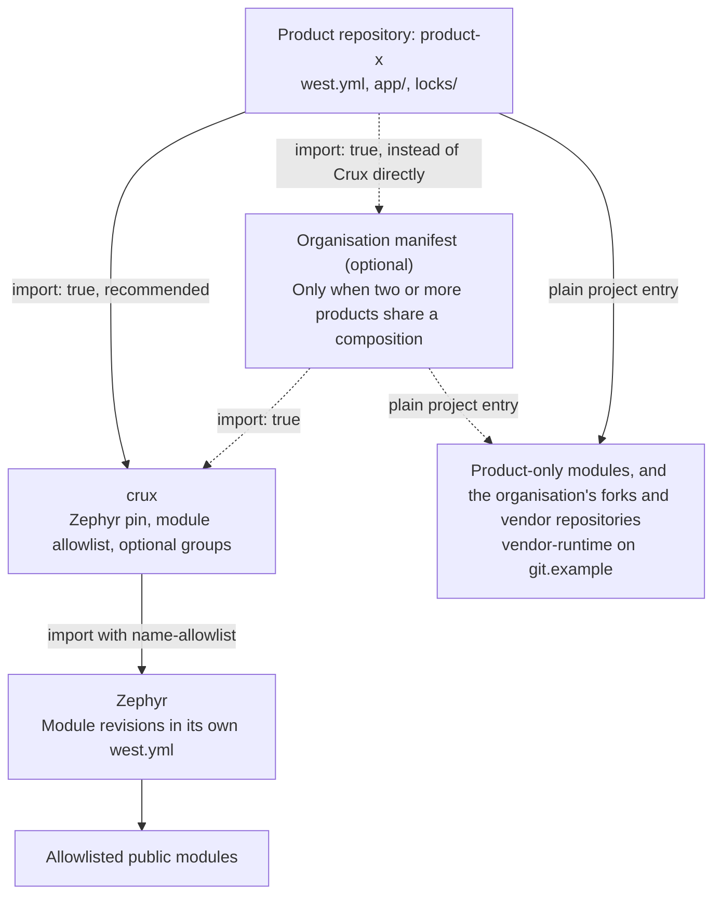
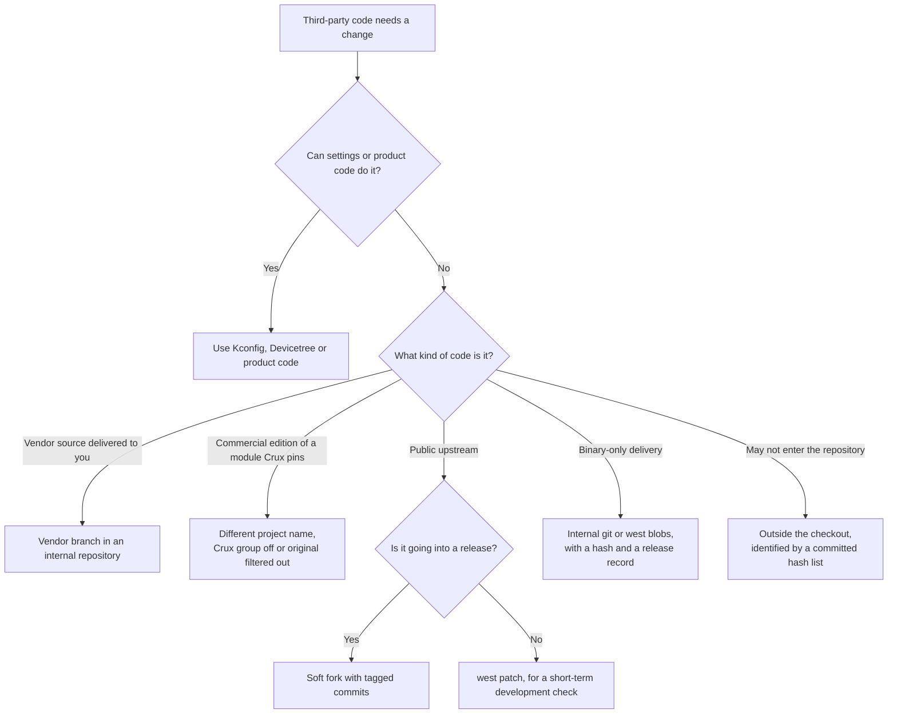
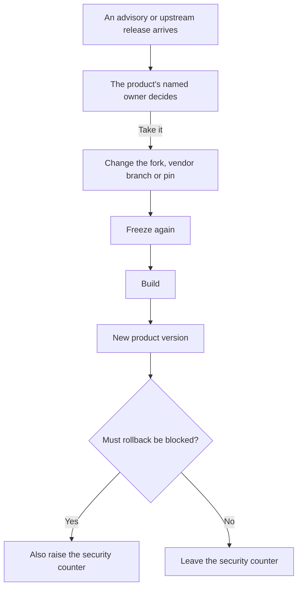
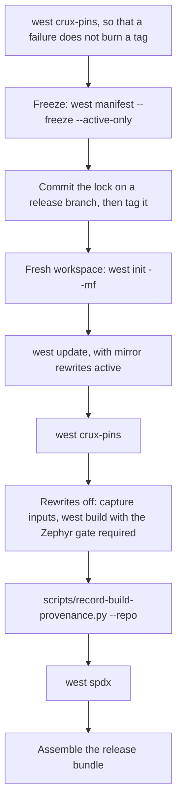

# Product Composition Guide

**Status: adopted practice, 2026-11-04.** The routes below are provisional until the first products have tried them. No Crux release tag exists yet: the first tag waits for that trial. A provisional schema and checker for the release bundle now exist in this repository, see [Release bundle](#release-bundle). They are not frozen, and no product release has been made with them. The baseline gate warns by default until consumers reach the baseline. This guide records how a product on Crux can compose, check, version and release its firmware, and what was run to support that. See [Limits](#limits).

Use it with the [product template](../templates/product/README.md), a small directory you copy to start a product repository. For other ways to consume Crux, see the [Build and Integration Guide](build.md).

## Who owns what

Dependencies run one way: product to Crux to Zephyr. Crux knows nothing about any product.

| Concern | Crux provides | The product owns |
| --- | --- | --- |
| Composition | An importable [`west.yml`](../west.yml): the Zephyr pin, the module allowlist and optional groups | Its own `west.yml`: the Crux revision, extra modules and overrides |
| Code | Public `crux::` usage targets and `<crux/...>` headers | Application code, Kconfig, Devicetree and board choices |
| Checks | `west crux-pins`, the Zephyr baseline gate and `scripts/record-build-provenance.py` | Running them in its own CI and keeping the results |
| Third-party changes | Only what Crux itself needs | The route it takes and the pin in its manifest. The organisation, not a product, owns each fork and vendor repository, its tags, its `-acmeN` counter and its carried-changes list |
| Versions | Its own tags, once they exist | The product version and its security counter |
| Release | A provisional [bundle schema and checker](release-bundle-checker.md), not frozen. No assembler, no signing and no SBOM reduction tool | The release branch, the lock file, signing and what goes outward. A public product repository publishes hashes only, see [Release bundle](#release-bundle) |
| Commercial modules | Nothing. Crux's manifest names only public modules | Their names, URLs and licences, in product or organisation manifests |

## Structure

The optional organisation manifest is a shared layer. Add it only when two or more products share a composition.

Where boards and drivers live, and how products share them through this layer, is in [Shared boards and drivers across products](shared-hardware-modules.md). How vendor kits with several maintained lines fit across repositories, how a build proves which delivery it compiled and what a release records about each kit is in [Vendor kits across repositories](vendor-kits.md), a recommended convention that is not adopted.



## Composition

The product uses west's T2 topology: the product repository is the manifest repository, and Crux and Zephyr are projects in its workspace.

The active part of the [template manifest](../templates/product/west.yml), with the comments of its `crux` entry:

```yaml
manifest:
  version: "1.2"
  remotes:
    - name: crux
      url-base: https://github.com/wonny-labs
  projects:
    - name: crux
      remote: crux
      # A template cannot name the Crux commit that holds it, so it follows main.
      # Pin a tag or SHA: run crux/scripts/update-crux-pin.py once, then
      # let the pin bot move it. See "Keeping the Crux pin current" in the guide.
      revision: main
      import: true
  self:
    path: product-x
```

This resolves Zephyr and every allowlisted module at the revisions Crux pins. The product repeats no revision. Importing is recommended, not required. See [Pinning by hand](#pinning-by-hand).

- **First definition wins.** West uses the first definition of a project name. Entries in the product manifest beat anything imported.
- **Optional groups are off by default.** Crux keeps its secure management stacks in the `crux-secure-management` group. An ordinary workspace does not fetch them. A second group, `crux-reliance`, holds the Reliance Edge file system source, which is GPLv2 only, and is off for the same reason. The wolfSSL TLS backend of those stacks needs a [Zephyr patch](../patches/zephyr/README.md#wolfssl-tls-socket-backend) that is not stored in this repository. How a product applies it is the owner's open decision under Issue #185: [HTTPS composition](https-composition.md#how-a-product-applies-the-wolfssl-patch) recommends that the product's own manifest pin a Zephyr fork with the patch applied (option B), and adopts nothing. Crux keeps MCUboot in the `crux-boot` group, at the revision in Zephyr's own manifest at Crux's Zephyr pin. It is Apache-2.0, so the group is off only to keep the fetch small. A product that builds a bootloader enables it with `group-filter: [+crux-boot]`, and does not add a plain `mcuboot` entry of its own. A `name-allowlist` entry would not do: Zephyr puts `mcuboot` in its own `bootloader` group, which Zephyr's `group-filter` keeps active, so MCUboot would be fetched unless Crux also filtered that group, and a product could not turn it on under a Crux group name.
- **A filter only narrows.** A product `name-allowlist` on the Crux import can remove what Crux allows. It cannot add what Crux left out.

| Goal | What to write | `west crux-pins` reports |
| --- | --- | --- |
| Use what Crux pins | `import: true` | `OK` |
| Enable an optional set | `group-filter: [+crux-secure-management]` or `[+crux-reliance]`, with no revision | `OK` |
| Enable the boot loader source | `group-filter: [+crux-boot]`, with no revision | `OK` |
| Add a product-only module | A plain project entry with its revision | `PRODUCT` |
| Replace a project Crux pins | An entry with the same name, its path, and `userdata: crux-override` | `OVERRIDE` |
| Use fewer modules | `import: name-allowlist: [...]` on `crux`, including `zephyr` | `OK` for what remains |
| Add a Zephyr module Crux did not allow | A plain project entry with its revision | `OK` at the revision in Zephyr's manifest. Another revision needs `crux-override` |
| Add such a module and own the module list | Redefine `zephyr`, with your own allowlist | `OK` while the Zephyr revision and modules match the contract |
| Import nothing | [Plain entries](#pinning-by-hand) for Crux, Zephyr and each module | `OK` while the pins match the contract |
| Import Zephyr only | [Crux as a plain entry](#pinning-by-hand), and `zephyr` with your own allowlist | `OK` while the pins match the contract |

Redefining `zephyr` drops Crux's Zephyr import. The product then owns the allowlist, and must repeat the Zephyr SHA and every module it needs.

### Pinning by hand

A product may pin Crux and Zephyr itself, with no `import`:

```yaml
  projects:
    - name: crux
      remote: crux
      revision: <Crux SHA>
      west-commands: scripts/west-commands.yml
    - name: zephyr
      remote: zephyrproject-rtos
      revision: <the SHA that Crux pins>
      west-commands: scripts/west-commands.yml
    - name: hal_nxp
      remote: zephyrproject-rtos
      revision: <the SHA in Zephyr's manifest at that pin>
      path: modules/hal/nxp
```

- **Commands.** With no import, west loads no commands from these projects. Without the `west-commands` line on `crux`, `west crux-pins` does not exist. Zephyr's own commands, such as `west build`, need the same line on `zephyr`.
- **The contract is unchanged.** `west crux-pins` still reads it from Crux at the pinned revision and from Zephyr at Crux's pin. Another Zephyr gives `MISMATCH`. A Zephyr module outside Crux's allowlist counts as `OK` if it matches Zephyr's manifest at Crux's pin.
- **The name `zephyr` is required.** Under any other name the command stops with `no zephyr project is pinned`.
- **Only what the workspace holds is reported.** A module the product left out gives no line.

A variant imports Zephyr only, with the product's own allowlist, and pins Crux as a plain entry:

```yaml
  projects:
    - name: crux
      remote: crux
      revision: <Crux SHA>
      west-commands: scripts/west-commands.yml
    - name: zephyr
      remote: zephyrproject-rtos
      revision: <the SHA that Crux pins>
      import:
        name-allowlist: [hal_nxp, <a module Crux did not allow>]
```

The contract is the same. Matching pins pass, and a module outside Crux's allowlist reports `OK` when it matches Zephyr's manifest at Crux's pin. Another Zephyr gives `MISMATCH`. Crux's optional projects are not in this workspace.

An older Crux revision has no `west crux-pins`, so such a product must first move its Crux pin to a revision that holds the command. The contract then comes from that revision.

## Checks

West itself does not reject a mismatched Zephyr. It accepts a manifest that picks another release without a warning. Two Crux checks make that visible.

### `west crux-pins`

This compares the workspace with the contract: the `west.yml` of the Crux repository that holds the command, plus the `west.yml` of Zephyr at the revision Crux pins. It reads Crux at the pinned revision when Crux is a project, under any name, and from the working tree when Crux is the manifest repository. A lock passed with `--mf` is never the contract.

It compares commits resolved by git, so a tag and its commit are equal. The workspace side is each project's `HEAD`, which must be what `west update` fetched (`manifest-rev`). Inactive projects are not reported.

| Output | Meaning | Exit |
| --- | --- | --- |
| `CONTRACT name sha` | The Crux project: where the contract came from. `(working tree)` follows when Crux is the manifest repository | 0 |
| `OK name sha` | Same commit as the contract | 0 |
| `OVERRIDE name sha (contract sha): reason` | Differs, with a declared `crux-override` reason | 0 |
| `PRODUCT name sha` | Not part of the contract | 0 |
| `MISMATCH name sha (contract sha)` | Differs, with no declared reason | Non-zero |
| `MISMATCH name sha: why` | The checkout is not what the manifest pins: `HEAD` left `manifest-rev`, or a SHA or tag in the manifest is not what west fetched. Run `west update`. No `crux-override` excuses this | Non-zero |

A contract revision that cannot be resolved is an error, never `OK`, and `crux-override` does not excuse it. So a fork must contain the commit that Crux pins.

Crux's own `west.yml` pins every project by full commit SHA, with any tag only in a comment, because `scripts/bootstrap-zephyr.sh` runs `west update --narrow`, which fetches no tags, and a tag in the contract would then not resolve with `git rev-parse`.

A branch revision is checked through `manifest-rev` alone, because west keeps no ref for it and a local branch of that name proves nothing. So a manifest edited to name another branch, with no `west update` after it, is not detected. The command uses no network, so it cannot see an upstream branch that moved after the last `west update`. A tag not yet fetched is treated the same way.

Matching is by project name, so a module replaced under a new name reports `PRODUCT`. `OK` describes `HEAD` only, so a change applied to the checkout without a commit still reports `OK`; the build record refuses that checkout.

Declare a difference in the product manifest:

```yaml
userdata:
  crux-override: "fix for acme issue 123, drop when upstream has it"
```

### A stale or mismatched pin

What a product sees depends on how the pin went wrong.

| Situation | What the product sees | Fix |
| --- | --- | --- |
| The Crux pin is older than `west crux-pins` | West reports that the command is unknown. See [Pinning by hand](#pinning-by-hand) | Move the Crux pin to a revision that holds the command, then `west update` |
| The manifest was edited and `west update` was not run | `MISMATCH name sha: why`, with a non-zero exit, when a SHA or tag in the manifest is not what west fetched. A changed branch name is not detected until `west update` has run ([`west crux-pins`](#west-crux-pins)) | `west update`, then `west crux-pins` |
| Zephyr or a module is pinned apart from Crux's pin | `MISMATCH name sha (contract sha)` | Take Crux's pin, or declare the difference with `crux-override` and a reason |
| The Crux pin is old but the workspace matches it | `OK` on every line. The contract is read from Crux at the pinned revision, so an old Crux is a consistent contract | `west crux-pins` cannot see this. Compare the pin with the revision you intend to use, and see the [compatibility table](compatibility-table.md) for what a revision carries |

Crux does not assert its own version in code, so a product that uses an API or Kconfig symbol its pinned Crux lacks fails in the ordinary way, with an unknown symbol or a missing header, and Crux adds no message. This is **Inference**: it was not run. A version assertion is not planned for now.

To move the pin, change the Crux `revision` in the product manifest to a newer SHA or tag, run `west update`, then `west crux-pins`. With `import: true` the Zephyr and module pins follow. With [hand pins](#pinning-by-hand) they must be moved to the new contract, or declared. [Upgrades and security fixes](#upgrades-and-security-fixes) covers what to review. The [pin bot](#keeping-the-crux-pin-current) opens one pull request per pin move.

### Zephyr baseline gate

The Crux Zephyr module compares the release numbers of the Zephyr in use with the release Crux was verified on, currently 4.5.0. A difference, or a version it cannot read, gives a CMake warning and the build continues. Crux evidence does not apply to that build. A fork with an `EXTRAVERSION` suffix stays quiet, because its release numbers are unchanged.

`-DCRUX_REQUIRE_VERIFIED_ZEPHYR=ON` turns the warning into an error that stops the build.

The gate runs while `CONFIG_CRUX_MODULE` is on, so an application that sets it to `n` turns the gate off with the module.

### Master switch name

The master switch of the Crux Zephyr module is `CONFIG_CRUX_MODULE`. It was renamed from `CONFIG_CRUX_PILOT_MODULE`, and there is no alias: a product that still sets the old name fails at configuration, because Zephyr rejects an assignment to an undefined symbol. To migrate, replace `CONFIG_CRUX_PILOT_MODULE` by `CONFIG_CRUX_MODULE` in every `prj.conf` and overlay. `CONFIG_ZEPHYR_CRUX_MODULE` is a different symbol that Zephyr makes from the module name, see [Module name](#module-name).

### Module name

`zephyr/module.yml` sets `name: crux`, so the symbols Zephyr generates for the module no longer depend on the folder Crux is checked out in. They are `CONFIG_ZEPHYR_CRUX_MODULE` in Kconfig and `ZEPHYR_CRUX_MODULE_DIR` in CMake. Before, Zephyr took the name from the folder, so a `crux-pilot` checkout and a checkout under another folder name gave different symbols. Zephyr keeps no alias for the old names. To migrate a product:

- Replace `ZEPHYR_CRUX_PILOT_MODULE_DIR` by `ZEPHYR_CRUX_MODULE_DIR` in CMake files.
- Replace `CONFIG_ZEPHYR_CRUX_PILOT_MODULE` by `CONFIG_ZEPHYR_CRUX_MODULE` in Kconfig, `prj.conf`, overlays and C code.

The master switch `CONFIG_CRUX_MODULE` is unchanged. `west.yml` places Crux at `crux`. `scripts/bootstrap-zephyr.sh` expects that folder and, until the consumers have moved, also accepts `crux-pilot`.

## Modifying third-party code

Use settings or product code if they can do it. Otherwise choose the route by the kind of code. These routes are provisional. See [Limits](#limits).



| Kind of code | Route | `west crux-pins` | What it costs |
| --- | --- | --- | --- |
| Vendor source delivered to you, not a public upstream | [Vendor branch](#vendor-branch) in an internal repository | `PRODUCT` | Each delivery is a merge, and a hash list to keep |
| Commercial edition of a module that Crux pins publicly | [Different project name](#commercial-editions) in the product manifest, with the Crux group off or the original filtered out | `PRODUCT` | The product tracks that edition itself |
| Public upstream the product must change, such as `zephyr` or `hal_nxp` | [Soft fork](#soft-forks) with tagged commits. Provisional until it is compared with patch files on a fresh workspace | `OVERRIDE` | SBOM identity, and the allowlist if the fork is `zephyr` |
| Binary-only delivery | Internal git or `west blobs`, with a hash and a release record | `PRODUCT` if in git | The `west blobs` HTTP fetcher passes no credentials. From Zephyr v4.5.0, a prebuilt library that a module declares is listed in the SBOM |
| Delivery that may not enter the repository | Keep it outside the checkout, identified by a committed hash list | Nothing | The build record does not cover it, so the release must record it separately |

### Vendor branch

Keep one vendor branch and one working branch per delivery line. [Vendor kits across repositories](vendor-kits.md) works through one kit with two lines, a module that compiles it and a product that pins one line. Import each delivery unmodified on its line's vendor branch, tag it and keep local changes as commits on the working branch. Merge each delivery into its line's working branch and pin the merge commit's SHA in `west.yml`.

A fix delivery for an older line stays on that line. On one linear vendor branch it would drag the current tree back. Use branch names that git allows beside each other, such as `vendor-1.x` and `work-1.x`, never `vendor/1.x` beside a branch `vendor`.

```sh
# The first delivery of line 1.x, in a new internal repository.
git switch -c vendor-1.x
# Unpack delivery 1.0.0 here, as received.
git add -A -f
git commit -m "vendor: import delivery 1.0.0"
git tag -a vendor/1.0.0 -m "delivery 1.0.0"
git switch -c work-1.x
# Commit local changes here, tagged as for a soft fork.

# A later delivery of that line. Removing the files first drops what the vendor dropped.
git switch vendor-1.x
git rm -rq .
# Unpack delivery 1.1.0 here, as received.
git add -A -f
git commit -m "vendor: import delivery 1.1.0"
git tag -a vendor/1.1.0 -m "delivery 1.1.0"
git switch work-1.x
git merge vendor/1.1.0

# A new line, from the delivery and the working branch before it.
git switch -c vendor-2.x vendor/1.1.0
git rm -rq .
# Unpack delivery 2.0.0 here, as received.
git add -A -f
git commit -m "vendor: import delivery 2.0.0"
git tag -a vendor/2.0.0 -m "delivery 2.0.0"
git switch -c work-2.x work-1.x
git merge vendor/2.0.0

# A fix delivery for line 1.x: the later-delivery steps again, on vendor-1.x and work-1.x only.
```

- **Durable refs.** Delivery tags stay. Each released SHA also gets a durable ref, as for a fork. Use a tag outside `vendor/*`, such as `work/1.0.1-acme1`, so that `git describe` below still names the delivery.
- **History of local commits.** `git log --no-merges vendor/1.1.0..HEAD`, naming the last delivery merged, lists them. A local commit stays listed after a later delivery absorbs it.
- **What is actually carried.** `git diff vendor/1.1.0 HEAD` states it, including what a conflict resolution changed.
- **Delivery identity.** The build record holds only the commit of each west project and names no delivery. `git describe --tags --match 'vendor/*' HEAD`, run in the project, names the last delivery merged, as in `vendor/1.1.0-2-g1a2b3c4`. The `2` counts commits since that tag, merges included, so it is not a count of local changes. `--abbrev=0` prints the tag alone. `release-manifest.json` must list, per vendor project, that delivery tag and the hash of its hash list.
- **SBOM.** A plain delivery appears in the SBOM only if it is a Zephyr module. That case was not built.
- **Import.** `-f` stops a `.gitignore` in the delivery from dropping files, but it also takes any stray file left in the directory, and line-ending settings can change what git stores. So check each delivery tag against its hash list.

Keep a hash list of each delivery as received, outside the vendor branch, so that the branch stays the delivery:

```sh
# In an empty directory, with delivery 1.1.0 unpacked as received.
find . -type f -exec sha256sum {} + | LC_ALL=C sort -k 2 > ../delivery-1.1.0.sha256
```

Then check the tag. Any output is a difference. A symlink in the delivery always shows as one, so check that by hand.

```sh
# In the repository. git cat-file gives the stored bytes, with no line-ending filter.
git -c core.quotePath=false ls-tree -r --name-only vendor/1.1.0 | while IFS= read -r file; do
    printf '%s  ./%s\n' "$(git cat-file blob "vendor/1.1.0:$file" | sha256sum | cut -d ' ' -f 1)" "$file"
done | LC_ALL=C sort -k 2 | diff - ../delivery-1.1.0.sha256
```

### Commercial editions

Give the edition a different project name, so that it reports `PRODUCT`.

- **Group or filter.** With the Crux group off, the original is inactive but still holds its path, and west rejects a second project on it. Use another path. To keep the path, or to enable the group for its other projects, filter the original out with `name-allowlist` on the Crux import.
- **Record.** The original gets no line of its own and the new name reports `PRODUCT`, with no stated reason. So list each replaced module in `release-manifest.json`.
- **Name.** Do not reuse the name unless the repository contains the commit Crux pins, because `west crux-pins` errors otherwise.
- **Licence.** A public edition's licence may not suit a closed product. For example, the public wolfSSL and wolfSSH are offered under GPL-3.0-or-later or a commercial licence, so check [their terms](../patches/zephyr/README.md#wolfssl-tls-socket-backend) before enabling `crux-secure-management`. The public Reliance Edge source is GPLv2 only, so check its licence in the same way before enabling `crux-reliance` in a product that distributes a binary.

### Soft forks

Tag each carried commit in its subject and add an `Upstream-Status` trailer.

| Tag | Meaning | Example trailer |
| --- | --- | --- |
| `[acme fromtree]` | Cherry-picked from upstream | `Upstream-Status: Backport abc123` |
| `[acme fromlist]` | Proposed upstream, not merged yet | `Upstream-Status: Submitted <link>` |
| `[acme noup]` | Not going upstream | `Upstream-Status: Inappropriate product-specific` |

Generate the carried-changes list from the fork:

```sh
git log --reverse --format='%h %s%n    %(trailers:key=Upstream-Status,valueonly)' v4.4.2..v4.4.2-acme3
```

- Pin a SHA in the manifest, with the tag in a comment.
- Keep a durable ref on each released fork SHA. `west update` fails on a SHA that no ref reaches.
- Declare the fork with `crux-override`, so that `west crux-pins` reports it with its reason.

The costs:

- Redefining `zephyr` drops Crux's Zephyr import, so the product restates the allowlist.
- A tag such as `v4.4.2-acme3` never gives the SBOM version or CPE. Only an exact `vX.Y.Z` tag does.
- An `ssh://` URL also loses the purl. Use `https://` URLs where possible, and see [SBOM](#sbom) for what a reduction must then remove.

### NXP code

Follow the `hal_nxp` revision that Zephyr's manifest pins. Do not mix in MCUXpresso SDK deliveries. A needed NXP fix goes into a `hal_nxp` fork as a cherry-pick. Which MCUXpresso release a `hal_nxp` revision corresponds to is not known.

### `west patch`

Use it for short-term development checks only. At Zephyr v4.4.2:

- Applying leaves the checkout modified, and a second apply fails.
- The build record refuses the patched checkout.
- After `git am`, `west update` exits 0 and drops the patch, with only a git warning.
- The boot banner stays at the upstream version.
- There is no `reverse` subcommand. The subcommands are `apply`, `clean`, `gh-fetch` and `list`.
- With `git apply`, a pin move that does not touch the file carried the diff across, and one that touches it failed.

### Sources replaced in this repository

This public repository replaces some Zephyr sources in the build without editing the Zephyr checkout, with the corrections in [patches/zephyr](../patches/zephyr/README.md). Five are single-file corrections: NXP ENET MDIO, Mbed TLS entropy, MMC cache flush, the HTTP header-phase deadline and the TCP initial sequence number, which every image that includes the Crux module gets when it has Zephyr's own TCP and `CONFIG_NET_TCP_ISN_RFC6528`. The sixth is the Settings File backend: for either Settings File selection of Configuration, `zephyr/settings_file.cmake` generates corrected copies of three Settings sources. For each, a script checks the original against the pinned Zephyr source and patches a temporary copy, and CMake replaces only those sources in the build. This suits a few files. For anything larger, use the routes above.

## Versions

| What | Form | Example | Notes |
| --- | --- | --- | --- |
| Crux | `v0.y.z`, SemVer | None yet | No tag exists yet |
| Fork | `v<upstream>-<org><n>` | `v4.4.2-acme3` | The upstream release, then a counter the organisation owns |
| Vendor delivery | `vendor/<delivery>` | `vendor/1.0.0` | The delivery as received, on its line's vendor branch |
| Released vendor-branch commit | `work/<delivery>-<org><n>` | `work/1.0.1-acme1` | A durable ref on the released SHA of a working branch |
| Product | `major.minor.patch+build` | `1.2.3+45` | Fits MCUboot's 8, 8, 16 and 32-bit fields |
| Security counter | A separate integer | `7` | Raised on its own schedule, not derived from the version |

The field widths limit the product version to major and minor up to 255, patch up to 65535 and build up to 4294967295. MCUboot is only an example. A product with another boot loader records its own image identity.

`v0.y.z` promises a recorded pin set, a stated Zephyr baseline and listed breaking changes. It makes no compatibility promise before `v1`. A Zephyr baseline move or a change to a pinned module is listed in the release notes and raises `y`, except a move within the module's own patch line, which a `z` release may carry.
The version source, the bump rules and the release triggers are in [ADR-0008](decisions/0008-versioning-and-release-rules.md). The table of pinned revisions in the release notes is generated from `west.yml`, never written by hand: see the [compatibility table](compatibility-table.md), a provisional generator.

## Keeping the Crux pin current

A product pins Crux by full commit SHA. A bot keeps one pull request open that moves the pin to the head of Crux `main`, and a person merges it.

- **Pin.** A full SHA, or a tag once Crux has them. A branch pin rebuilds differently from day to day, as Yocto's `AUTOREV` does, and the [build record](#release) refuses it.
- **One bot pull request.** The bot rebuilds the branch `bot/crux-pin` as one commit on the product's `main` and updates the one open pull request, as the Chromium autoroller and Renovate or Dependabot do, instead of opening one per Crux commit. Its text lists the Crux commits since the old pin. Zephyr moves its own module pins with reviewed manifest pull requests in the same way.
- **Checks.** The product's usual pull request checks, including `west crux-pins` and the build.
- **Merge.** A person merges. To adapt the product to a Crux change, push a commit to the bot branch. As in Renovate, the bot then stops refreshing the branch until the branch is deleted, which a merge does when the branch is set to close on merge. A person who amends the bot's commit instead loses that edit at the next run.
- **Early warning.** A scheduled build against Crux `main` that commits nothing reports a break before the next bot run.
- **Release branches.** The bot never moves them. They keep their frozen manifest, as Android's `repo` snapshot manifests do, see [Release](#release).

A team may later let the bot pull request merge itself. Allow it only on the default branch and only when every condition holds, enforced by required checks:

- All required checks pass, including `west crux-pins` and the build with `-DCRUX_REQUIRE_VERIFIED_ZEPHYR=ON`.
- ROM and RAM use stay within the product's budgets.
- The new pin contains the old one. The bot's text warns when it does not.
- No Crux commit in the range is marked breaking (`!` or `BREAKING CHANGE` in Conventional Commits).
- No person has pushed to the bot branch.

### The command

Run `crux-pin-bot.py` from the product repository in a west workspace that holds Crux. It needs Python 3, Git and PyYAML, which west installs.

Run the scripts from the Crux checkout at the revision the product pins, as `west update` leaves it, never from Crux `main`. Crux `main` is read only as data, through `git ls-remote` and a fetch for the log. A new version of the scripts then reaches a product only through a reviewed pin move, and a Crux commit never gets the product's write token unreviewed. A product whose Crux pin predates the scripts moves its pin once by hand. Give the token access to the one product repository only, to write contents and pull requests. Use the command in one job only when the hook runs nothing from the new Crux. A hook that runs `west update`, a build or tests belongs in a job without the token, and the token stage must be a separate one, see [Keeping the token from the build](#keeping-the-token-from-the-build).

```sh
cd product-x
python3 ../crux/scripts/crux-pin-bot.py --host github
```

It runs the two scripts below and exits `0` when the pull request is open and current, when the pin is already current, and when a person's commit kept the bot branch from being refreshed, with a warning. Anything else is an error. It takes `--manifest`, `--project`, `--to`, `--remote-url` and `--no-hook` of `update-crux-pin.py`, the options of `open-pin-pr.py` except `--message-file`, with `--allow-path` defaulting to the manifest, `--crux-branch` for the Crux branch to follow, and `--append-body FILE`, which may repeat, to add product evidence such as image hashes to the pull request text but not the commit. It runs the updater and the hook without the token's variable and without the `--user-env` variable, and only `open-pin-pr.py` gets them. It reads `open-pin-pr.py` before the hook runs and runs that copy, because a hook that runs `west update` moves the Crux checkout, the scripts included. It records the SHA-256 of `.git/config` before the hook and passes it as `--git-config-sha256`. After a person's commit on the bot branch the command also exits `0`, with a warning, because it must not overwrite that commit. A bot pull request that stays open and is not refreshed then needs a person's look.

| Variable | Use |
| --- | --- |
| `CRUX_PIN_TOKEN` | The token, for both hosts. Another name with `--token-env NAME` |

- **GitHub.** A GitHub App token or fine-grained token with contents and pull request write access, passed to `gh` as `GH_TOKEN`. Without one, `gh` uses its own login. A pull request pushed and opened with the default `GITHUB_TOKEN` starts no other workflow, so its checks would not run.
- **Bitbucket Cloud.** A repository or workspace access token with the `pullrequest:write` scope, sent as a Bearer token. With `--user-env NAME`, it is sent with the user name or e-mail address in that variable as Basic authentication instead.

The push goes to the `url` of the remote `origin`, never to its `pushurl`, or to `--push-url`, with the job's own Git credentials, which must be allowed to push the bot branch: an SSH key in the agent, or the header that the checkout stored in `.git/config`. A CI checkout that keeps the credential outside `.git/config`, or rewrites the remote, needs `--push-url` with the product's own URL, as a Jenkins checkout over HTTPS does. Git credential helpers are not used. The commit uses the repository's Git identity, or `Crux pin bot` when none is set.

### The two scripts

`update-crux-pin.py` resolves the target to a full SHA, rewrites only the `revision:` value of the Crux project and drops that line's comment, which described the old revision. Exit status `0` means the pin moved, `3` that it is already current. Anything else is an error.

| Option | Default | Use |
| --- | --- | --- |
| `--manifest PATH` | `west.yml` | The product manifest |
| `--project NAME` | `crux` or `crux-pilot` | The Crux project |
| `--to REV` | Head of `--branch` | A full SHA, branch or tag. A short SHA is refused. A full SHA is taken as given |
| `--branch NAME` | `main` | The Crux branch to follow, resolved with `git ls-remote` |
| `--remote-url URL` | The manifest's URL | A mirror |
| `--summary FILE` | None | Write a commit message: a title, a blank line, the Crux log |
| `--checkout PATH` | Found from `.west` | The Crux checkout passed to the hook |
| `--log-limit N` | 100 | The most commits to list |
| `--no-hook` | Off | Skip the hook |
| `--dry-run` | Off | Leave the manifest alone and run no hook. `--summary` is still written |
| `--token-env NAME`, `--user-env NAME` | `CRUX_PIN_TOKEN`, none | Variables kept from Git and the hook |

If the product has an executable `scripts/crux-pin-hook`, it runs after the move, from the product root, so the product can update files that quote the pin, such as tests or documents. It never gets the token's variable. Its exit status `0` means success. Any other status fails the run with status `1` and leaves the manifest updated, so the bot opens no pull request.

| Variable | Value |
| --- | --- |
| `CRUX_PIN_OLD`, `CRUX_PIN_NEW` | The old revision and the new SHA |
| `CRUX_PIN_PROJECT` | The Crux project's name |
| `CRUX_PIN_MANIFEST` | The manifest's absolute path |
| `CRUX_PIN_CHECKOUT` | The Crux checkout, still at the old revision, or empty when none was found |

`open-pin-pr.py` commits the working tree's changes on top of `HEAD`, with a `Pin-Bot: open-pin-pr` trailer. Every changed or untracked file must lie under `--allow-path`, or it commits nothing and fails with the list. Repository hooks do not run in either script, and their Git processes do not get the token's variable. `open-pin-pr.py` also turns off `core.fsmonitor` and credential helpers for every Git call, and pushes to an explicit URL. With `--git-config-sha256`, it refuses to push when `.git/config`, followed by `config.worktree` when there is one, no longer has that SHA-256, which is what `sha256sum .git/config` prints for a plain clone. A token that the checkout stored in `.git/config` stays there for the push. It pushes the commit to the bot branch with `--force-with-lease`, and creates or updates the pull request. When the branch already holds the same change, it pushes nothing and leaves the open pull request's text alone, so evidence added to it stays. It never merges, never prints the token and never pushes another branch. Exit status `0` means the pull request is open and current, `3` that the working tree has no change, `4` that the bot branch holds a commit without the trailer. Anything else is an error.

| Option | Default | Use |
| --- | --- | --- |
| `--host` | Required | `github`, through `gh`, or `bitbucket-cloud`, through the REST API 2.0 |
| `--message-file FILE` | Required | The title line, a blank line and the pull request text. Keep it outside the repository |
| `--base NAME` | `main` | The target branch |
| `--branch NAME` | `bot/crux-pin` | The bot branch. `main`, `master`, `release*` and the base are refused |
| `--remote NAME` | `origin` | The remote whose `url` is pushed to. Its `pushurl` is ignored |
| `--push-url URL` | The remote's `url` | Push to this URL instead |
| `--git-config-sha256 HEX` | None | Refuse to push unless `.git/config` still has this SHA-256, recorded before the hook or a build ran |
| `--repo NAME` | Inferred by `gh` | `OWNER/REPO`, or `WORKSPACE/REPOSITORY`, required for Bitbucket |
| `--token-env NAME` | `CRUX_PIN_TOKEN` | The token's variable |
| `--user-env NAME` | None | Basic authentication for Bitbucket, see above |
| `--api-url URL` | `https://api.bitbucket.org/2.0` | The Bitbucket API root, `https` only |
| `--append-body FILE` | None | Add the file to the pull request text, not the commit. May repeat |
| `--allow-path PATH` | `west.yml` | A file or directory, from the repository root, that the commit may change, such as one the hook updates. May repeat |

### Keeping the token from the build

The hook and everything a job runs after it run as the same user as the bot. Without the token's variable in their environment, they can still read it from a parent process (`/proc/<pid>/environ`), and they can write what later steps trust: the scripts of the Crux checkout, `.git/config` entries such as `pushurl` and `core.fsmonitor`, `git replace` refs, staged files, and the manifest and pull request text. A process that a build leaves running in the same container can read the token too. `open-pin-pr.py` turns off what it can and refuses a changed `.git/config`, but only a separate stage in its own container keeps the token from the build.

Run the token stage with `crux-pin-stage.py`, in its own, freshly started container, and let it take nothing from the build's workspace:

1. **Update, without the token.** Resolve the target, move the pin with `update-crux-pin.py --to TARGET`, run the hook, then build and test. This stage's only outputs are the target SHA and pass or fail. Do not hand its files, its manifest or its summary to the next stage.
2. **Propose, with the token, in a fresh container.** `crux-pin-stage.py prepare` clones the product and Crux itself into an empty directory. It proposes nothing when the product's `main` has moved since the build. It refuses a target that is not on Crux `main` and a target that does not contain the pinned revision, so a build cannot choose an older commit. It takes `update-crux-pin.py` and `open-pin-pr.py` from Crux at the revision the clean manifest pins, never from the new revision, writes the manifest and the pull request text with them, and refuses to run from a copy of itself that differs from the pinned one. `crux-pin-stage.py propose` then runs only `open-pin-pr.py`, as `python3 -I -S`, with `PATH=/usr/bin:/bin` and a small environment, with Git ignoring the system and user configuration and ssh ignoring `~/.ssh/config`, and with `--push-url` set to the product URL it cloned. The wrapper takes the stage script from Crux at the pinned revision, and `prepare` checks that it did.

Because the stage clones everything itself, a build cannot change the commit's contents, the pull request text or the scripts. A product whose Crux pin predates `crux-pin-stage.py` moves its pin once by hand first.

| Option | Use |
| --- | --- |
| `prepare --workdir DIR` | An empty or missing directory that is not part of a workspace |
| `--product-remote URL`, `--crux-remote URL` | The URLs to clone. The product URL is also what is pushed to |
| `--product-commit SHA` | The product commit the build used. Another head on the product's `main` ends with status `3` |
| `--target SHA` | The full Crux SHA the build verified |
| `--crux-branch NAME` | The Crux branch the target must be on (default `main`) |
| `--manifest PATH`, `--project NAME` | As for `update-crux-pin.py` |
| `propose --workdir DIR` | The directory `prepare` filled. Takes `--host`, `--repo`, `--api-url`, `--base`, `--branch`, `--token-env`, `--user-env`, `--allow-path` and `--append-body` as for `open-pin-pr.py`, and `--path` for the `PATH` of the push (default `/usr/bin:/bin`) |

`prepare` exits `0` when it is ready, `3` when there is nothing to propose and `1` on an error. `propose` exits `0`, also when a person's commit kept the bot branch from being refreshed, and `1` on an error.

Conditions on the CI system:

- Every stage that runs code has its own container, removed when the stage ends. No stage gets the container runtime's socket, host process or IPC namespaces, extra privileges or volumes from another container. `/tmp` is local to the container.
- The image has Git 2.32 or later, `python3` in `/usr/bin`, and PyYAML that `python3 -I` can import. `/usr/bin:/bin` must hold `git`, `python3` and, for ssh remotes, `ssh`.
- The token stage's container has the hosts' keys in `~/.ssh/known_hosts` or `/etc/ssh/ssh_known_hosts`, because the scripts run ssh with `-F /dev/null` and so read no `ssh_config`. It can clone both remotes and push `bot/crux-pin` to the product remote, with an ssh agent or another credential that does not live in a configuration file. The token's scope is the pull requests of the one product repository and the push to the bot branch.
- The container runtime passes the token to the process without putting its value on the host's command line. Check this, or mount the host's `/proc` with `hidepid=2`.

The stage keeps the token from a build and from the new Crux. It does not protect against the CI system itself, or someone who can change the pipeline, reading the token. `crux-pin-bot.py` in one job suits a hook that only edits files.

### CI wrappers

Run the command on a schedule, hourly to daily, one run at a time, on fresh checkouts. Turn the schedule on only once the token exists and the pin has reached a Crux commit that holds the scripts. A shallow checkout works, but the script then fetches the whole history, so the examples fetch it at once. These examples use `product-x` and a Crux project named `crux`, as the template does. Replace both names with your own. Both split the run as above. The GitHub Actions example takes the manifest and the text from the update job, which a person reviews before merging; only the Jenkins example uses `crux-pin-stage.py`, which closes that gap.

GitHub Actions. The update job has no token. The propose job's checkout keeps the token in `.git/config` for the push, so add no other steps to that job.

```yaml
name: Crux pin
on:
  schedule: [{cron: "17 3 * * *"}]
  workflow_dispatch:
concurrency: crux-pin
permissions: {contents: read}
jobs:
  update:
    runs-on: ubuntu-24.04
    outputs: {moved: "${{ steps.pin.outputs.moved }}"}
    steps:
      - uses: actions/checkout@v4
        with: {path: product-x, persist-credentials: false}
      - uses: actions/setup-python@v5
        with: {python-version: "3.12"}
      - id: pin
        run: |
          pip install west==1.4.0
          west init -l product-x && west update crux
          mkdir "$RUNNER_TEMP/pin" && cd product-x
          status=0
          python3 ../crux/scripts/update-crux-pin.py --summary "$RUNNER_TEMP/pin/message.txt" || status=$?
          if [ "$status" = 3 ]; then echo moved=false >> "$GITHUB_OUTPUT"; exit 0; fi
          [ "$status" = 0 ] || exit "$status"
          cp west.yml "$RUNNER_TEMP/pin/" && echo moved=true >> "$GITHUB_OUTPUT"
      # Build and test the new pin here, still without the token.
      - if: steps.pin.outputs.moved == 'true'
        uses: actions/upload-artifact@v4
        with: {name: crux-pin, path: "${{ runner.temp }}/pin"}
  propose:
    needs: update
    if: needs.update.outputs.moved == 'true'
    runs-on: ubuntu-24.04
    steps:
      - uses: actions/checkout@v4
        with: {path: product-x, fetch-depth: 0, token: "${{ secrets.CRUX_PIN_TOKEN }}"}
      - uses: actions/setup-python@v5
        with: {python-version: "3.12"}
      - uses: actions/download-artifact@v4
        with: {name: crux-pin, path: "${{ runner.temp }}/pin"}
      - env: {CRUX_PIN_TOKEN: "${{ secrets.CRUX_PIN_TOKEN }}"}
        run: |
          pip install west==1.4.0
          west init -l product-x && west update crux
          cp "$RUNNER_TEMP/pin/west.yml" product-x/west.yml
          cd product-x && python3 ../crux/scripts/open-pin-pr.py --host github \
            --message-file "$RUNNER_TEMP/pin/message.txt" --allow-path west.yml
```

Jenkins with Bitbucket Cloud, as a thin declarative pipeline on Docker agents with the product's Dev Container image. A pipeline that builds that image itself passes `--build-arg CRUX_JLINK=0`, so it never downloads the J-Link software from SEGGER ([CI and automated image builds](board-jlink-usbipd.md#ci-and-automated-image-builds)). The logic is in `update-crux-pin.py` and `crux-pin-stage.py`. Each stage starts its own container, and the Propose stage takes nothing from the Update stage's workspace. `crux-pin-token` holds the access token, `crux-pin-read` a read-only key that may clone both repositories, and `crux-pin-ssh` a key that may also push the bot branch. The Update stage, which runs the new Crux's code, gets only the read-only key: a build that could push could put a commit on the bot branch and so stop every later pin move. Set `PRODUCT_REMOTE` and `CRUX_REMOTE` to the repositories' ssh URLs.

```groovy
pipeline {
  agent none
  triggers { cron('H 3 * * *') }
  options { disableConcurrentBuilds(); skipDefaultCheckout() }
  environment {
    PRODUCT_REMOTE = 'ssh://git@git.example/acme/product-x.git'
    CRUX_REMOTE = 'ssh://git@git.example/acme/crux.git'
  }
  stages {
    stage('Update') {
      agent { docker { image 'registry.example/acme/product-x-dev:1' } }
      steps {
        deleteDir()
        dir('product-x') { checkout scm }
        sshagent(['crux-pin-read']) {
          script {
            env.PRODUCT_COMMIT = sh(returnStdout: true, script: 'git -C product-x rev-parse HEAD').trim()
            env.CRUX_TARGET = sh(returnStdout: true,
                                 script: 'git ls-remote "$CRUX_REMOTE" refs/heads/main | cut -f1').trim()
            sh 'west init -l product-x && west update crux'
            def status = sh(returnStatus: true, script: '''
              cd product-x
              python3 ../crux/scripts/update-crux-pin.py --to "$CRUX_TARGET" --remote-url "$CRUX_REMOTE"
            ''')
            // Status 3: the pin is current, so the Propose stage is skipped.
            if (status != 0 && status != 3) { error "update-crux-pin.py failed with status ${status}" }
            // Build and test the new pin here, still without the token.
            env.PIN_MOVED = status == 0 ? 'true' : 'false'
          }
        }
      }
    }
    stage('Propose') {
      when { beforeAgent true; expression { env.PIN_MOVED == 'true' } }
      agent { docker { image 'registry.example/acme/product-x-dev:1' } }
      steps {
        deleteDir()   // The workspace may be the Update stage's: start empty.
        sshagent(['crux-pin-ssh']) {
          script {
            // No token yet: clone, read the pin and take the stage script from Crux at that revision.
            def status = sh(returnStatus: true, script: '''
              rm -rf /tmp/crux-pin && mkdir /tmp/crux-pin && cd /tmp/crux-pin
              git clone -q "$PRODUCT_REMOTE" product0
              pinned=$(python3 -I -c 'import sys, yaml; p = yaml.safe_load(open(sys.argv[1]))["manifest"]["projects"]; print(next(x["revision"] for x in p if x["name"] in ("crux", "crux-pilot")))' product0/west.yml)
              git clone -q --filter=blob:none --no-checkout "$CRUX_REMOTE" crux0
              git -C crux0 show "$pinned:scripts/crux-pin-stage.py" > stage.py
              python3 -I stage.py prepare --workdir /tmp/crux-pin/work --product-remote "$PRODUCT_REMOTE" \
                --crux-remote "$CRUX_REMOTE" --product-commit "$PRODUCT_COMMIT" --target "$CRUX_TARGET"
            ''')
            // Status 3: nothing to propose, such as a product that moved since the build.
            if (status != 0 && status != 3) { error "crux-pin-stage.py prepare failed with status ${status}" }
            if (status == 0) {
              withCredentials([string(credentialsId: 'crux-pin-token', variable: 'CRUX_PIN_TOKEN')]) {
                sh 'python3 -I /tmp/crux-pin/stage.py propose --workdir /tmp/crux-pin/work --host bitbucket-cloud --repo acme/product-x'
              }
            }
          }
        }
      }
    }
  }
}
```

The Propose stage starts with an emptied workspace and takes nothing from the Update stage. The token is bound only around `propose`, and `crux-pin-stage.py` passes it to `open-pin-pr.py` alone. Replace `acme/product-x` and the image with your own.

## Upgrades and security fixes



- **Owner.** Each product names one owner.
- **Maintenance branch.** A released product is maintained on a maintenance branch from its release tag.
- **Support period.** Each product must set its own. This guide gives no number.

### Crypto library pins

Crux pins `mbedtls` and `tf-psa-crypto` from Zephyr's forks, in the optional group `crux-secure-management`. A pin is an upstream release plus Zephyr's commits, and it follows Zephyr's own pin at the Zephyr tag unless a [dependency review](dependency-review.md) moves it. At Zephyr v4.5.0 they are the revisions that Zephyr's manifest pins (Mbed TLS 4.1.1 and TF-PSA-Crypto 1.1.1). The policy is [ADR-0006](decisions/0006-cryptographic-dependency-policy.md). `west crux-pins` reports the pin, not the library line or version. To see those, use the pin base check of the [guide](dependency-review.md#check-what-a-pin-is) and the release notes line that a pin move adds.

A product **can**:

- Take Crux's pins as they are.
- Move both pins to a later Zephyr-fork revision in its own manifest, and declare each with `crux-override`, with the advisory and the review as the reason. Crux's evidence does not cover that pin, so the product owns its own.

A product **must**:

- Keep `mbedtls` and `tf-psa-crypto` from the same line, as Zephyr pins them.
- Review the advisories against its own configuration and code with the [guide](dependency-review.md). Crux's review covers Crux's components and Mbed profile, not a product's TLS client, PKCS #7, RSA or certificate validation.
- Record which crypto line and version each released product carries.
- Meet the licence terms of every group it enables. The wolf projects are GPL-3.0-or-later or commercial.

### Taking a Zephyr patch release

A Zephyr patch release such as 4.5.1 trips both checks until Crux moves its baseline.

- **`west crux-pins`.** It reports `MISMATCH` on `zephyr` and on each module whose pin moved with it.
- **Baseline gate.** The [gate](#zephyr-baseline-gate) compares exact release numbers, so the build warns, and `-DCRUX_REQUIRE_VERIFIED_ZEPHYR=ON` stops it. A required build then needs the option dropped, or Crux's baseline moved first.

To take the release in the product:

1. Redefine `zephyr` at the new revision, with `crux-override`.
2. Restate the allowlist under its `import`, because redefining `zephyr` drops Crux's.
3. Add an entry with `crux-override` for each module the new manifest moved, with its name, path and new revision. Each `MISMATCH` still reported names one.

```yaml
    - name: zephyr
      url: https://github.com/zephyrproject-rtos/zephyr
      revision: <the SHA of the patch release>
      import:
        name-allowlist: [<each module you need>]
      userdata:
        crux-override: "zephyr patch release, drop when Crux moves its baseline"
    - name: hal_nxp
      url: https://github.com/zephyrproject-rtos/hal_nxp
      revision: <the SHA in that release's manifest>
      path: modules/hal/nxp
      userdata:
        crux-override: "follows the zephyr patch release"
```

Then `zephyr` and each moved module report `OVERRIDE`, and the rest `OK`. Each commit Crux pins must stay reachable, or the command stops with an error that no override excuses. For a SHA pin, `west update` fetches every branch and tag of the remote, so the commit Crux pins need not be an ancestor of the new pin. `west update --narrow` fetches only the pin's history, so there it must be one.

## Release

Release from a fresh workspace and a frozen manifest. West does not update a project's git remote when a manifest URL changes, so a reused workspace can record an old location.



Freeze with `--active-only`, because plain `--freeze` fails when a declared optional project is not cloned.

```sh
west crux-pins
mkdir -p product-x/locks
west manifest --freeze --active-only > product-x/locks/west.frozen.yml
git -C product-x switch -c release/1.2
git -C product-x add locks/west.frozen.yml
git -C product-x commit -m "build: lock the manifest for 1.2.3"
git -C product-x tag -a product-x-1.2.3 -m "product-x 1.2.3"
git -C product-x push origin release/1.2 product-x-1.2.3
```

Build in a fresh workspace. Replace `<board>` with your board target.

```sh
west init -m https://git.example/scm/acme/product-x --mr product-x-1.2.3 \
    --mf locks/west.frozen.yml release-1.2.3
cd release-1.2.3

# Mirror rewrites, if you use them, are active for this one command.
GIT_CONFIG_GLOBAL="$HOME/mirror.gitconfig" west update
west crux-pins

python3 crux/scripts/record-build-provenance.py --repo product-x --workspace . \
    --capture-inputs product-x/build/inputs.json
west build -b <board> -d product-x/build/app product-x/app -- -DCRUX_REQUIRE_VERIFIED_ZEPHYR=ON
west build -d product-x/build/app -t rom_report
west build -d product-x/build/app -t ram_report
python3 crux/scripts/record-build-provenance.py --repo product-x --workspace . \
    --build-dir product-x/build/app --target <board> --inputs product-x/build/inputs.json
west spdx -d product-x/build/app
```

- **West configuration.** The build record hashes `.west/config`. The first time that west runs an extension command in a workspace, such as `west crux-pins`, it adds `zephyr.base` to that file, whichever extension command runs first, `west build` included. A capture taken before that command and a record taken after it then differ, and the record stops with "Source or workspace inputs changed during verification". Run `west crux-pins` before the capture, as above. `west update` and `west list` leave the file unchanged. `west config zephyr.base zephyr` writes the same line when the project named `zephyr` has the path `zephyr`.
- **Zephyr gate.** On its own the [baseline gate](#zephyr-baseline-gate) warns and the build continues. A release passes `-DCRUX_REQUIRE_VERIFIED_ZEPHYR=ON`, so another Zephyr release or an unreadable version stops the build. A release that uses another Zephyr on purpose leaves the option out and records why.
- **Mirror rewrites.** `url.<base>.insteadOf` rules belong in a separate Git configuration file that is used only for `west update`. If the rules are active at build time, modules are marked `-off` and the SBOM records the mirror location.
- **Pinned workspace.** The build record resolves each project's revision in its checkout, so it fails on a workspace that follows `revision: main`. Run it on the frozen workspace.
- **Build directory.** The record refuses a build directory outside `--repo`. The template's `.gitignore` keeps `build/` out of the source tree the record hashes.
- **Container recipe.** `--devcontainer DIR` names the recipe. By default the record uses `<repo>/.devcontainer` if present, otherwise Crux's own. It records a recipe only for a build inside a container. A build of Crux itself, with neither `--repo` nor `--devcontainer`, stops without its recipe and writes no record.
- **Lock file.** The record's `west_manifest_sha256` is the hash of `west.yml`, not of the lock. The lock is covered by the source snapshot, and `west_projects` lists each commit.
- **Toolchain.** West has no field for it. Pin it through the SDK version and container image recorded in the bundle.

### Build path

Build at the same absolute path when you compare two builds of one source. The evidence for this is limited, so the rule is only as strong as that.

- **ELF files differ.** In [Stage 8](evidence/boot-update/stage8-reproducibility-and-signing.md), builds with different build directories gave ELF files that differed only in `.debug_info`, `.debug_line` and `.debug_str`, which hold the path. The unsigned `zephyr.bin` of all four pairs was byte-identical. The signed images differed only in the signature. That trial varied the build directory only, in one container, on an older trial tree. It did not vary the source or workspace path, and no rebuild at one path was made to confirm the path as the sole cause. Nothing has compared two real builds of the current composition ([boot reproducibility](boot-reproducibility.md)).
- **What Zephyr strips.** Zephyr's `CONFIG_BUILD_OUTPUT_STRIP_PATHS` (on by default; Crux does not change it) passes `-fmacro-prefix-map` for the application source, `ZEPHYR_BASE` and the west top directory, so `__FILE__` does not carry them. Zephyr adds no `-fdebug-prefix-map` or `-ffile-prefix-map`, and the Crux presets and scripts add none, so debug sections keep the path. **Inference** from reading Zephyr 4.4.0 CMake: a path outside those three directories, in a macro or an assertion, could still reach the image. Not tested.
- **Compare an ELF or its map only from the same path.** Compare flashable images (`zephyr.bin`, `.hex`) from another path only as a check that was expected to pass, not as a guarantee: a difference there means rebuild at the first path before you suspect the source.
- **A prefix map is untested here.** On a host `clang` object file, `-fmacro-prefix-map` alone left the path in the debug info, and adding `-ffile-prefix-map` removed it, so the objects from two paths were identical. That is an illustration of the flags, not a Crux or Zephyr build. Whether the option would make a Crux ELF path-independent is **Not verified**, and it is not adopted.

### Release bundle

A bundle is a folder of text items and one `release-manifest.json` that lists the hash of each other item. It holds hashes and identities, never an image.

A provisional schema and checker for it exist in this repository: the manifest schema [`docs/schemas/release-manifest.schema.json`](schemas/release-manifest.schema.json) and the checker [`scripts/check-release-bundle.py`](../scripts/check-release-bundle.py). [Release bundle schema and checker](release-bundle-checker.md) describes them, what the checker refuses and what it cannot detect. They are not frozen before a product's first real release, and no product release has been made with them. The assembler that writes the bundle is not built, so a product writes its own bundle for now. The checker is the last step before an item leaves the repository, and it only reads.

| Item | Source | Audience |
| --- | --- | --- |
| Firmware image | `build/app/zephyr/zephyr.bin` | Outward to customers through a private delivery channel only. In a public product repository, publish only its SHA-256, in the release manifest. Never attach the image, `.elf` or `.map` as a release asset or CI artefact |
| `licences/` | The licence texts of what the image contains | Outward |
| Outward SBOM | Reduced by the product from the full set | Customers |
| `release-manifest.json` | Schema version, product version, release tag, toolchain (SDK) version, build image (container, runner or host), build target, hashes of the bundle's items, the SHA-256 of the image, the firmware identity and the name of its algorithm. Per vendor project, its delivery tag and the hash of its hash list. Each module replaced under a new name. The schema refuses any other top-level field, so a product's own fields, such as a security counter, and any other delivery the build record does not cover go in `extensions` | Internal |
| Build record | `build/app/provenance.json` | Internal |
| Lock file | `locks/west.frozen.yml` at the release tag | Internal |
| Pin report | Output of `west crux-pins` | Internal |
| Carried-changes list | For each fork and vendor branch, the history of local commits, `git log --no-merges <last-delivery-tag>..HEAD`, and what is actually carried, `git diff <last-delivery-tag> HEAD`. A fork names its upstream tag in place of the delivery tag | Internal |
| Full SBOM | `build/app/spdx/` | Internal. Authorities receive it on request |
| Debug files | `build/app/zephyr/zephyr.elf` and `zephyr.map` | Internal only |

A public product repository publishes hashes only. This is the owner's binaries policy for product repositories: the firmware image, `.elf` and `.map` are never a release asset or a CI artefact, and customers receive the image through a private delivery channel. For the bundle, the checker enforces hashes only by default, and it has no mode that allows an image. It refuses a bundle that holds a file with an image suffix such as `.bin`, `.elf` or `.map`, a file that starts like an ELF, or a file whose SHA-256 equals the manifest's image hash. So in a public product repository the firmware image and the debug files of the table are not bundle items, and the manifest holds the image's hash. A mode for a private product that keeps the image in its bundle does not exist. It would be added when such a product needs it, with its own review. The rule is not a Crux-wide rule. The CI of crux itself uploads test and sample images built from public source (ELF, BIN and map files, kept 14 days) as provenance checks and board-test evidence, an exception the owner accepted.

The checker's no-image rules are structural, its path scan is a pattern and its private-string scan is a substring match, and the manifest is not signed, so the hashes show integrity and not origin. See [What is faked or heuristic](release-bundle-checker.md#what-is-faked-or-heuristic).

Repairing identity and adding prebuilt libraries applies from the first release, also for the internal set. See [SBOM](#sbom). The reduction tool waits until an SBOM first goes outward.

## Identity

`firmware_identity` in `provenance.json` is for comparing builds across workspaces. It holds the build target, the hash of `zephyr.bin` and the hash of `.config` with its comment lines removed. Lines of the form `# CONFIG_X is not set` stay, because they carry meaning.

One real measurement backs the table. The template application, built from one frozen manifest at two workspace paths on a GitHub runner, gave the same `firmware_identity` and the same `zephyr.bin`. Its `build_id`, `.elf` and whole-file `.config` differed. One application is not a general proof. See [Limits](#limits).

| Value | Compare across workspace paths? | Why |
| --- | --- | --- |
| `firmware_identity` | Yes | Comes from the image and the decided configuration |
| `build_id` | No | Hashes `.elf`, `.map`, the whole `.config` and tool paths |
| `.elf`, `.map` | No | Hold absolute paths |
| Whole-file `.config` | No | Its comment lines hold absolute paths |

Signing was not tested. Whether identity is taken before or after signing is undecided.

## SBOM

At Zephyr v4.5.0, from its release notes and migration guide:

- `west spdx` needs `CONFIG_BUILD_OUTPUT_META`, which the template sets. The build itself prepares what `west spdx` reads, so run `west spdx -d <build>` after the build. Do not run `west spdx --init`, which Zephyr plans to remove in 5.0.
- It emits SPDX 2.3 by default and SPDX 3.0 with `--spdx-version 3.0`; SPDX 3.1 is experimental.
- Prebuilt libraries linked into the image are listed, with the version and URL that their module declares.
- Zephyr and its modules get a purl pinned to the built revision, and Zephyr a CPE built from its `VERSION` file.

What follows was read in the source at v4.4.2 and not read again at v4.5.0:

- It does not support `native_sim`.
- A default set exposes file names, copyright text and internal URLs. Reduce it before giving it outward.
- `zspdx/walker.py` `_build_purl` accepts only `git@` and `http(s)://` URLs, so a fork on an `ssh://` URL gets no purl.
- Only an exact `vX.Y.Z` tag gives the package version and the CPE, so a fork tag such as `v4.4.2-acme1` does not. A release step can add the upstream base identity back. A fork on an `https://` URL was not tested.
- A repair step must cover each modified package, including the module dependency records in `modules-deps.spdx`, whose references come from `module.yml` and not from the fork.
- `_build_purl` on an `https://` URL gives a purl that carries the host and path, so a reduction must remove it for an internal host. The host without its last label becomes the purl type, and the tag, when one is passed, follows `@`. `https://git.example/scm/acme/zephyr` gives `pkg:git/scm/acme/zephyr`, and `@v4.4.2` is appended for that tag.
- The walker builds a purl for each tag on the Zephyr commit, so an organisation string in a fork tag on an `https://` URL appears in the outward SBOM unless it is removed.

A real product must scan its own image for private strings. `.elf` and `.map` stay internal.

## Linux

Linux products are not covered yet. There is no Yocto layer, and none is planned before a real consumer exists.

## Limits

**What was run**

- A throwaway proof of concept built one small application that links `crux::time`. It used Zephyr v4.4.2, west 1.4.0 and SDK 1.0.1, in the amd64 Dev Container image under emulation. It was a cross-build only, for the current EVKB target. Nothing ran on a board. It exercised the composition, fork, `west patch`, SBOM, frozen-manifest and two-path image comparisons. Its copy of the application is not byte-for-byte the template's.
- That proof of concept ran prototype versions of the pin check and the gate, not the ones in this repository. Its `.config` comparison across paths also removed `# CONFIG_X is not set`, which `firmware_identity` keeps.
- `tests/build/test_product_template.py` runs the template manifest through real west 1.4.0, `west crux-pins`, the frozen-manifest flow and input capture for the build record. West 1.4.0 is the version that the Zephyr workflow and the Dev Container pin, and the Host CI job installs it and runs the tests that need it. The tests use local throwaway repositories in place of every remote and build nothing with Zephyr.
- A one-off check on a GitHub runner followed the release flow in this guide through the template's own manifest, against the real upstream repositories. It used the tools in this repository, with `-DCRUX_REQUIRE_VERIFIED_ZEPHYR=ON`, at two workspace paths. `west crux-pins` reported `OK`, the build record passed, and `firmware_identity` and `zephyr.bin` were identical. Builds with `-DBUILD_VERSION` set were also byte-identical across the two paths. With Zephyr v4.4.0 in the manifest, `west crux-pins` failed on `zephyr` and `hal_nxp`, a default configure warned and continued, and the required option stopped it. That check is not part of CI.
- `scripts/test-product-template.sh <board>` runs in one [shard](ci-zephyr-shards.md#shards) of the Zephyr workflow, and that workflow does not run for [documentation-only changes](ci-zephyr-shards.md#documentation-only-changes). It runs the west-based tests, runs `west crux-pins` on Crux's own workspace and cross-builds `app/`.
- `tests/build/test_product_template.py` also takes these routes through real west 1.4.0 and `west crux-pins`: a vendor branch across two deliveries, delivery lines with a fix on the older one, the hash-list check, a commercial edition under a new project name, a reused project name that must fail, a hand-pinned manifest with no import or with a Zephyr-only import, and the steps for a Zephyr patch release. All of these used invented local repositories. None of these routes built anything with Zephyr.
- `tests/build/test_crux_pins.py` runs `west crux-pins` through real west 1.4.0 on local throwaway repositories, and `tests/build/test_zephyr_baseline.py` evaluates the gate in `zephyr/CMakeLists.txt` with a mock Zephyr. Neither uses a real Zephyr build.
- `tests/build/test_update_crux_pin.py`, `tests/build/test_open_pin_pr.py` and `tests/build/test_crux_pin_bot.py` run the pin scripts on local throwaway Git repositories, with a fake `gh` and a local fake of the Bitbucket Cloud pull request API. No real GitHub, Bitbucket or Jenkins job ran them.

**What was not run**

- A regular CI build through the template's own manifest. `scripts/test-product-template.sh <board>` runs in the Zephyr workflow, but it builds inside Crux's own workspace.
- A real hosted git server. Local repositories stood in for it, so server behaviour, authentication and clone URL forms are untested.
- A real commercial module or vendor delivery. `vendor-runtime` was an invented stand-in. A vendor merge with a conflict was not tried.
- The comparison of a soft fork with patch files on a fresh workspace.
- `west blobs`, or a delivery kept outside the checkout. What this guide says of `west blobs` comes from reading its source at v4.4.2.
- A real product bundle through the [release bundle checker](release-bundle-checker.md). Its tests use invented bundles, and nothing was built with Zephyr for them. The assembler is not built.
- Signing, a physical board, or a baseline upgrade through a fork.
- A real Zephyr patch release, or the baseline gate on one. The steps above ran on fake repositories only.
- A vendor project built as a Zephyr module. What this guide says of its place in the SBOM, and of a purl on an `https://` URL, comes from reading `zspdx/walker.py` at v4.4.2.
- More than one application or SDK. Image comparison across paths holds for that one case, on each machine it ran on.
- Linux, Yocto or any other build system.
