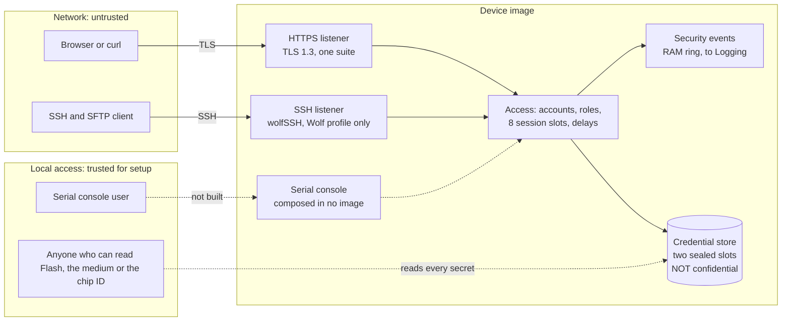
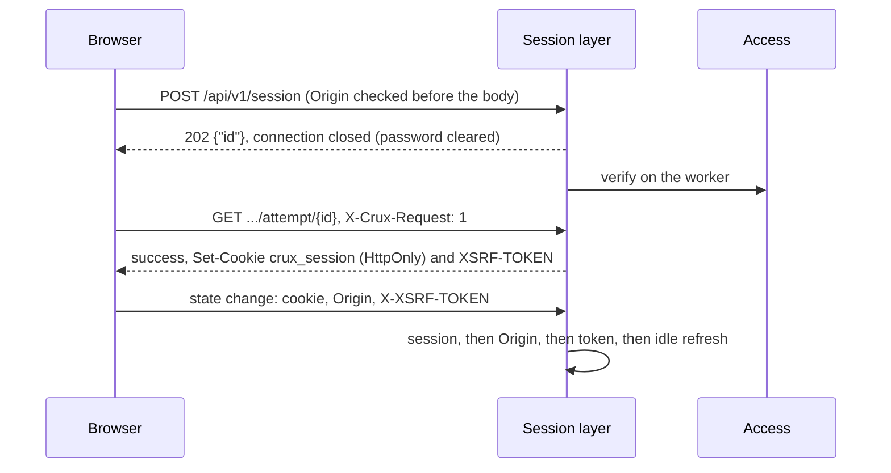

# Secure management: a review guide

Status: a guide for a reviewer who must judge the secure communication and management stack of Crux for a real product, from the documents alone. It adds no behaviour and no decision. Each claim cites the code, a test or a document that was read on `origin/main` for this guide, and a claim that could not be checked is marked **unverified**. A product checks its own board with its own board test procedure; this repository has none for the management services (an earlier unrun draft is kept in the [project history](history/secure-management-board-test-procedure.md)). Terms are in [the glossary](management-glossary.md), and the product integration steps are in [secure management in a product](management-in-a-product.md).

**Nothing in the management stack has run on a board.** Every result is a Host test, a `native_sim` run or a compile for RT1060-EVKB. Two board compositions exist and neither has run: the RT1060-EVKB bench image on the Wolf profile, which refuses to start in `main()` and has never been programmed, and the [Mbed management image](rt1060-mbed-management-image.md) (HTTPS only, Mbed profile), which `psa-crypto.yml` cross-builds, without flashing, on each pull request and push to `main`; the step passed on `main` at `164b0428`: [what is verified, and where](#what-is-verified-and-where).

| Word | Meaning here |
| --- | --- |
| **Host** | A Host test, usually on fakes of the layers around the code under test |
| **`native_sim`** | The code a product links ran on Zephyr's `native_sim`, with real cryptography and real clients, on the host's TCP stack and a **test-only entropy source** ([what "real" means there](psa-crypto-design.md#what-real-means-on-native_sim)) |
| **Compile** | Compiled (and for the bench image, linked) for `mimxrt1060_evk@B//qspi`. Nothing ran. |
| **Board** | Ran on a physical board. **No management result has this level.** |

## The security model as built

### Trust boundaries

| Boundary | What protects it | Source |
| --- | --- | --- |
| Network to HTTPS | TLS 1.3 only, `TLS_AES_128_GCM_SHA256`, no plain listener and no redirect; a missing certificate means nothing listens | [HTTPS composition](https-composition.md#declared-tls-profile), [no plain listener](https-composition.md#no-plain-http-listener-and-no-redirect) |
| Network to SSH | wolfSSH with a fixed algorithm list, `max_auth_attempts` 3, a 30 s login timer, 4 connections | [Product guide, SSH](management-in-a-product.md#ssh), [Kconfig](management-in-a-product.md#kconfig) |
| Channels to Access | Every channel logs in through Access, which holds one session table, one delay table and the role check | [Access contract](access-contract.md) |
| Access to storage | The credential store seals each slot with a key derived from the device ID; it is **not confidential** against someone with the medium and the chip ID | [Credential store](credential-store.md#limits) |
| Serial | Provisioning of the first account is refused on every origin but serial. The origin is what the calling code declares: the rule trusts the composition's own code, as the bench step declares a serial origin in code (`tests/zephyr/management_rt1060_compile/first_account/bench_first_account_provision.c`) | `components/access/adapter/crux_access_adapter.h` (`crux_access_provision_first_account`), [ADR-0004, phasing](decisions/0004-product-composition-of-management-services.md#phasing-and-the-licence-boundary) |

### Accounts, roles and sessions

| Item | As built | Source |
| --- | --- | --- |
| Roles | Crux holds the mechanism; the **product supplies the role table** (`crux_access_policy_t`). The test compositions define `guest`, `viewer`, `operator` and `administrator`, with an idle limit of 15 min and an absolute limit of 8 h. | `tests/native/management_composition/composition/crux_native_management.c` (`roles`, `policy`) |
| Permissions | Strings compared exactly, for example `status.read`, `events.read`, `access.manage`, `tls.manage` | `components/mgmt_status/include/crux/management_status.h`, `components/security_event/include/crux/security_event.h`, [TLS permissions](tls-certificate.md#permissions) |
| Session slots | 8, slot 0 reserved for serial, so 7 shared by HTTPS and SSH; 3 per account across both channels, a fourth ends the oldest | `components/access/src/access_port.h`, [session limits](ssh-integrated-image.md#session-limits-when-both-listeners-are-busy) (`native_sim`) |
| Password verifier | PBKDF2 through PSA; `CRUX_ACCESS_VERIFIER_ITERATIONS` is 10,000, **an unmeasured placeholder** | [Access bounds](access-contract.md#bounds) |
| Login delays | 5 free failures, then delays from a 1 s base up to a 60 s cap, kept in tables per source and per name (32 buckets each) | [Access bounds](access-contract.md#bounds), `tests/access/security.c` |
| Equal treatment | A wrong password, an unknown name and a disabled account give the same answer on every channel | [Web rules](web-session.md#rules), [serial console](cli-contract.md#serial-console), `tests/access/security.c` |
| User keys for SSH | Access accepts only `ssh-ed25519` and `ecdsa-sha2-nistp256`, the two types SSH offers; a P-384 or P-521 key is `INVALID_ARGUMENT`. A key of such a type that an earlier revision stored is skipped: it never authenticates, init reports it as `access.key_failed`, saves keep it unchanged, and every other account and key works. No command or route registers a key; the product calls `crux_access_account_add_key` itself. | `components/access/src/access_record.c`, `tests/access/keys.c`, `tests/access/faults.c`, [user key types](access-contract.md#user-key-types-issue-316), [registering a user key](management-in-a-product.md#registering-a-user-key) |

### Web login, CSRF and `Origin`

A login is two requests: `POST /api/v1/session` queues the attempt and answers `202` with an identifier, and the client polls `GET /api/v1/session/attempt/{id}` with `X-Crux-Request: 1`. Password verification runs on one worker, one attempt at a time. The full flow is in [web session](web-session.md#how-a-login-flows).

| Control | As built | Shown by |
| --- | --- | --- |
| Cookies | `Secure; SameSite=Strict; Path=/`, the session cookie `HttpOnly`, no persistent expiry | `tests/web/session/login.c`, `tests/native/web_session/test_driver.py` |
| Tokens | 256 bits from the PSA random port; stored as SHA-256 hashes | [Web rules](web-session.md#rules) |
| CSRF | Every method but `GET` needs `X-XSRF-TOKEN` equal to the `XSRF-TOKEN` cookie; else `403 csrf_rejected` | `tests/web/session/sessions.c` |
| `Origin` | Scheme, `://` and the request's own `Host`, compared whole, or an exact list from the composition; else `403 origin_rejected` | `tests/web/session/sessions.c`, `login.c` |
| Headers | CSP, `nosniff`, `no-referrer`, `no-store`; **no HSTS and no CORS header** | [Web rules](web-session.md#rules) |
| Events for a refused CSRF token or `Origin` | The web session module emits `web.csrf_rejected` (0x0601) for a refused token and `web.origin_rejected` (0x0605, Experimental) for a refused `Origin`, also on a login, with the result `DENIED` and at most 3 per kind in 60 s. A request with no session (`401`) and a poll without `X-Crux-Request` leave no event. **Tested on the Host only**; the bench image links the provider, and no run has shown a record. | `tests/web/session/events.c`, `events_provider.c`; [web session](web-session.md#security-events-for-a-refused-csrf-token-or-origin), [Issue #319](https://github.com/wonny-labs/crux-pilot/issues/319) |

### The credential store

| Item | As built | Source |
| --- | --- | --- |
| Contents | Accounts, device keys (the TLS key and the SSH host key) and the certificate, in two sealed slots on a Crux File provider | [Credential store](credential-store.md) |
| Confidentiality basis | `BASIS_DEVICE_ID_KEY`, declared with **no confidentiality**: someone who can read the medium and the chip ID can read every secret | `test_info_carries_the_declaration` in `tests/credential/conformance.c`, [limits](credential-store.md#limits) |
| Rollback | Not detected; losing both directory entries reads as empty and **reopens provisioning** (S6) | `test_accepted_limits`; `test_lost_directory_entries_reopen_provisioning` in `tests/credential/access_store.c` |
| Power loss | Walked byte by byte on a fake medium only; no real card under a cut | `tests/credential/faults.c`, [what is untested](credential-store.md#what-is-untested) |

### The TLS certificate

| Item | As built | Source |
| --- | --- | --- |
| Key and certificate | P-256 key from the store, self-signed certificate at first boot, valid from 2026-01-01 to 9999-12-31 by default | [What the device generates](tls-certificate.md#what-the-device-generates) |
| Upload | One DER certificate, checked for **format and key match only**: no chain, no signature, no dates, no revocation | [What an upload is checked for](tls-certificate.md#what-an-upload-is-checked-for), `tests/tls_certificate/install.c` |
| Private key in RAM | One PKCS #8 copy for the life of the program, handed to Zephyr's TLS credentials | [The private key](tls-certificate.md#the-private-key) |
| First connection | Trust on first use: compare the SHA-256 fingerprint that the composition prints | [The first connection](tls-certificate.md#the-first-connection) |
| Routes and commands | **None.** No web route and no command requests, installs or regenerates a certificate, or shows its fingerprint. | [Routes](management-in-a-product.md#routes), [CLI contract](cli-contract.md#what-exists) (`device fingerprint` not built) |
| What a listener serves | Every `native_sim` composition serves the **declared test certificate, whose key is public**. Only the two board images register a generated certificate with `tls_credential_add` (`tests/zephyr/management_rt1060_compile/src/mgmt_start.c`, `samples/boards/nxp/mimxrt1060_evk/web_management/src/composition.c`), and neither has run. | [TLS certificate](tls-certificate.md#what-is-built-faked-and-untested) |

### Security events and the flood bound

Records go into a RAM ring and a low-priority thread writes each as one Logging line with the tag `crux.security`, for example `evt=access.login_failed seq=184 ... res=denied` ([log line](security-event-contract.md#log-line)). Nothing persists across a reset, and nothing is tamper-evident. `GET /api/v1/events` is **not built**; the read function it would use, `crux_security_event_read`, exists and needs `events.read`.

| Bound | Value | Source |
| --- | --- | --- |
| Ring | 32 records; routine (R) records dropped from 24 pending, change (C) records admitted until full | [Admission](security-event-contract.md#admission), `tests/security_event/ring.c` |
| Loss | Counted, reported as an `event.lost` line with `first` and `count` | [Loss](security-event-contract.md#loss) |
| Drain pacing | 4 lines, then a 100 ms pause | [Pacing](security-event-contract.md#pacing), `tests/security_event/drain.c` |
| Secrets | No password, key, salt or verifier in any record or line | `tests/security_event/secrets.c`, `tests/access/secrets.c` |
| Per-identifier rate limit | Only the web session module's window for its two forgery events (3 per kind in 60 s). `ssh.auth_limit` has no rate bound of its own; the ring is the bound. | [The bound](web-session.md#the-bound), [SSH adapter port](security-event-contract.md#from-the-ssh-adapter-port) |
| Logging threshold | Must stay at `INFO` or more verbose (E6); **nothing enforces it** | [Limits](security-event-contract.md#limits) |

## The channels

| Channel | Stack | State | Licence note |
| --- | --- | --- | --- |
| HTTPS web | Zephyr HTTP server behind the Crux route table, on **either** TLS profile: Mbed TLS with TF-PSA-Crypto, or wolfSSL with wolfPSA | `native_sim` on both profiles. In CI on Mbed only. | Mbed TLS and TF-PSA-Crypto are Apache-2.0 OR GPL-2.0-or-later ([patches README](../patches/zephyr/README.md#wolfssl-tls-socket-backend)) |
| Command line over serial | `crux_cli` login loop and `!setup` over `crux_serial` | **Host only. Composed in no image.** LPUART3 wiring compiles for RT1060-EVKB (`tests/zephyr/cli_serial_compile`). | |
| SSH command line and SFTP | wolfSSH provider, Wolf profile only; `CONFIG_CRUX_SSH` is refused with Mbed | `native_sim` with OpenSSH 9.6; two recorded WinSCP runs ([SFTP design](sftp-design.md#winscp)) | See below |

**Licence of the Wolf profile.** wolfSSL and wolfSSH are offered under GPL-3.0-or-later or a commercial licence, and wolfPSA's source states GPL-3.0-or-later only. The Wolf profile also needs a Zephyr TLS socket patch from `wolfSSL/osp` that this repository does not store, because its terms are unconfirmed ([patches README](../patches/zephyr/README.md#wolfssl-tls-socket-backend)). Per the cited documents, a closed product that wants SSH or SFTP from this stack therefore needs a commercial licence, or another SSH stack. The route for applying the patch is open, with option B (a Zephyr fork in the product's own manifest) recommended ([HTTPS composition](https-composition.md#how-a-product-applies-the-wolfssl-patch)). **This guide does not decide any licence question.** The RT1060-EVKB bench image is built on the Wolf profile, so even its HTTPS checks need the Wolf stack. The [Mbed management image](rt1060-mbed-management-image.md) uses no Wolf stack and no GPL source: HTTPS only, on Mbed TLS with TF-PSA-Crypto.

## Threat model summary

| Threat | Control | Residual risk, as documented |
| --- | --- | --- |
| Password guessing over the network | Shared delay table, equal answers, one verification at a time | Four uncollected login results hold every attempt slot for 20 s, so one client can keep logins at `503` ([web decision 2](web-session.md#decisions-taken-without-an-answer)) |
| Cross-site request forgery | `SameSite=Strict`, synchronizer token, `Origin` check | A rate-limited event, tested on the Host only; past 3 per kind in 60 s refusals are only counted ([web session](web-session.md#the-bound)) |
| Eavesdropping, downgrade | TLS 1.3 only, one suite; SSH without CBC, SHA-1 or `diffie-hellman` | Clients without TLS 1.3 cannot connect (by published support, not tested) |
| Impersonation of the device | Trust on first use of a printed fingerprint | No route shows the fingerprint; the composition must print it |
| Slow or silent clients | Bounds, not defences: 3 HTTP clients, a 2 s handshake stall each, 4 SSH connections held for 30 s | A web client that trickles its headers is closed at the header deadline, 10 s by default, but one that reconnects holds a slot for up to that long per connection, and a body trickled after the server's own plain `404` or `405` has no time limit ([#268](https://github.com/wonny-labs/crux-pilot/issues/268), [#529](https://github.com/wonny-labs/crux-pilot/issues/529), [web contract](web-contract.md#trickled-headers-the-header-phase-deadline)); four silent SSH clients lock SSH out |
| Event flood hiding other records | Class R and C admission, counted loss | A flood costs other routine records; nothing is persisted |
| Physical access to the medium or Flash | None: the store is not confidential | Every secret is readable. The bench image also holds its first-account password in plaintext in Flash ([bench first account](rt1060-bench-first-account.md#what-the-image-holds)). |

The model rests on these **assumptions**, each from the cited document and none tested on a target:

1. An attacker on the network cannot read the device's medium, Flash or chip ID ([credential store](credential-store.md#limits)).
2. The entropy source of the target is sound. Every run so far used a test-only source, so no token or key strength is shown ([web session](web-session.md#what-is-not-verified)).
3. The person at the serial console during setup is trusted, and the first account comes from a password that person types, with nothing in the image ([what a product does instead](rt1060-bench-first-account.md#what-a-product-does-instead)).
4. Users compare the certificate and host key fingerprints on first connection.
5. The product binds the listeners to a management interface (`CONFIG_CRUX_WEB_BIND_ADDRESS`, `CONFIG_CRUX_SSH_BIND_ADDRESS`); by default they listen on every address.
6. The image has no Zephyr shell: the shell rule refuses `CONFIG_SHELL` in a management image that is not marked as a development image ([shell rule](cli-contract.md#zephyr-shell-rule)). No document records the image check on an image that sets `CONFIG_CRUX_WEB` or `CONFIG_CRUX_SSH`.

## What is verified, and where

| Area | Host | `native_sim` | Target compile | Board |
| --- | --- | --- | --- | --- |
| Access, roles, delays | Yes, `tests/access/` | Yes, real PSA ports | Inside the bench image (local) and the Mbed image (CI) | **No** |
| Credential store | Yes, `tests/credential/` | Yes, FatFs over a RAM disk | Inside the bench image (local) and the Mbed image (CI) | **No** |
| Security events | Yes, `tests/security_event/` | Yes: counts only, nothing on a wire | Inside the bench image (local) and the Mbed image (CI), to Logging on LPUART1 | **No** |
| HTTPS, login, CSRF, `Origin` | Yes, `tests/web/session/` | Yes, both TLS profiles; browser runs in Chrome | Web adapter on Mbed in CI (`scripts/test-web.sh target mbedtls`); the Mbed image in CI; the bench image on Wolf, locally | **No** |
| TLS certificate | Yes, `tests/tls_certificate/` | Yes, generated and reloaded, but **not served** | Registration in the bench image (local) and the Mbed image (CI) | **No** |
| Serial console, `!setup` | Yes, `tests/cli/` | **No** | LPUART3 wiring only, in CI | **No** |
| SSH command line, SFTP | Yes, fake provider | Yes, OpenSSH 9.6, local only (no workflow) | Inside the bench image | **No** |
| `ssh.auth_limit`, `ssh.host_key_missing` | Yes, `tests/ssh/access/security_events_test.c` | **No run shows a record** | Compiled in | **No** |

What exists for a board, exactly:

- **One bench image**, `tests/zephyr/management_rt1060_compile`: HTTPS, the command line over SSH and SFTP on the Wolf profile, address `192.168.77.2/24`, with four declared bench test forms: a test host key form, no time source, a RAM disk (nothing persists), and a first-account password embedded from a file. `CRUX_BENCH_RUN_REFUSED` is `ON` (`CMakeLists.txt`), so the image prints its banner, the `CRUX-ENTROPY` line and `BENCH refusing to start: this image is not approved to run` (`src/main.c`), and stops; `tests/build/test_management_bench_declaration.py` pins this. One local cross-build is recorded, not in CI ([bench plan](rt1060-bench-image-plan.md#the-image-that-was-built)).
- **One Mbed-profile image meant to run**, `samples/boards/nxp/mimxrt1060_evk/web_management`: HTTPS only, no refusal switch, a RAM disk, and a test-only first account that is off by default. Its static Host checks run (`tests/build/test_management_mbed_rt1060_image.py`), and its cross-build check, `scripts/test-management-mbed-rt1060.sh build`, runs in CI: `psa-crypto.yml` runs it, without flashing, on each pull request and push to `main`; the step passed on `main` at `164b0428`, and the script checks that the linked ELF defines the start functions of the services and holds no Wolf or SSH symbol. It has not run on a board ([Mbed management image](rt1060-mbed-management-image.md)).
- **A plan for a board run**, which is not an approval and has not run. Its blocker table has nine rows; by its [state of 2026-11-14](rt1060-bench-image-plan.md#state-on-2026-11-14) the tool rows are merged, and still open are the first real freeze and the registration of the bench profile, the refusal in `main()` (B3), the named reset step (B5) and the approval itself (B9) ([what blocks the plan](rt1060-bench-image-plan.md#what-blocks-the-plan-today)).
- No record under `docs/evidence/` shows a management image running on a board.

## Test evidence matrix

| Claim | Backed by | Level |
| --- | --- | --- |
| The CSRF token and `Origin` are checked on every method but `GET` | `tests/web/session/sessions.c`; `tests/native/web_session/test_driver.py` | Host, `native_sim` |
| Login replies do not reveal whether a user exists | `tests/web/session/login.c`; [web cases](web-session.md#tests) | Host, `native_sim` |
| The password does not stay in the server's buffers | `tests/web/session/login.c` (marker password) | Host |
| Sessions are shared and capped across HTTPS and SSH | `case_slots_with_both_busy`, `case_sessions_across_channels` in `tests/native/management_ssh/driver.py` | `native_sim` |
| No plain HTTP listener | [Listener check](https-composition.md#no-plain-http-listener-and-no-redirect); `case_ports` in `tests/native/management_ssh/driver.py` | `native_sim` |
| The store declares no confidentiality | `test_info_carries_the_declaration` | Host |
| A product core refuses the test-only store ports | `tests/credential/production_refuses.c` | Host |
| A malformed or mismatched certificate upload is refused and logged | `tests/tls_certificate/install.c`, `events.c`, `differential.c` | Host |
| No secret in an event | `tests/security_event/secrets.c` | Host |
| A routine flood cannot evict change records | `tests/security_event/ring.c`, `ring_small` | Host |
| SSH offers no RSA, CBC or SHA-1 | [Provider results](ssh-wolf-provider.md#results) | `native_sim` |
| `ssh.auth_limit` is reported once at the limit | `case_auth_limit_is_reported_at_the_limit` in `tests/ssh/conformance.c` | Host, fake provider only |
| No Zephyr shell in a management image | `scripts/check-management-shell.py`, `tests/build/test_management_shell.py` | Host, builds |
| The bench image refuses to start | `tests/build/test_management_bench_declaration.py` | Host |

## Open items

| Item | Current position | Current recommendation | Status |
| --- | --- | --- | --- |
| User key types ([#316](https://github.com/wonny-labs/crux-pilot/issues/316)) | Decided: option A, Access accepts only `ssh-ed25519` and `ecdsa-sha2-nistp256` | A stored key of an unsupported type is skipped, reported and kept (decided 2026-11-26) | Implemented, Host tests ([stored keys of an unsupported type](access-contract.md#stored-keys-of-an-unsupported-type)) |
| Header deadline ([#268](https://github.com/wonny-labs/crux-pilot/issues/268)) | Decided: option B, a header-phase deadline as a build-local Zephyr patch; a reconnecting client still holds a slot for one period | Option B, as decided | Implemented: `CONFIG_CRUX_WEB_HEADER_DEADLINE_MS`, default 10 s, through `patches/zephyr/http-header-deadline.patch` ([patches README](../patches/zephyr/README.md#http-header-phase-deadline)); its `native_sim` cases are recorded in the pull request that adds it. A body trickled after the server's own plain `404` or `405` is still unbounded. The bench image's declared patch list is not updated |
| Events for refused file operations ([#270](https://github.com/wonny-labs/crux-pilot/issues/270)) | Direction accepted; the row table is in the [SFTP design](sftp-design.md#each-refusal-and-its-event) | No event for an ordinary client's refusal or one that stops before the port, with a recorded reason; one rate-limited event for a session's bound of open files or listings ([SFTP design](sftp-design.md#the-decision-for-the-refusals-with-no-event-270)) | The first criterion, a decision per row, is still open; no event implemented |
| A possibly false `ssh.auth_limit` on wolfSSH ([#317](https://github.com/wonny-labs/crux-pilot/issues/317)) | Emitting both SSH identifiers is built. A changed user name or a fatal `key_verified` result may end a connection with the same wolfSSH error, reporting a limit that was not reached; whether wolfSSH counts a refusal before a callback is also unknown | Run it on wolfSSH with `scripts/test-ssh-provider.sh` or a `native_sim` image; revisit if keyboard-interactive or `WOLFSSH_ALLOW_USERAUTH_NONE` is ever enabled ([decision 29](ssh-wolf-provider.md#decisions-for-review)) | **Unverified** on wolfSSH |
| CSRF and `Origin` events ([#319](https://github.com/wonny-labs/crux-pilot/issues/319)) | Decided: option A with rate limiting | Option A, as decided | Implemented (`web.csrf_rejected`, `web.origin_rejected`), tested on the Host only |
| First account on a product | Accepted in [ADR-0004](decisions/0004-product-composition-of-management-services.md#phasing-and-the-licence-boundary) (C5): the serial first-account step comes before any board image ("phase 1b") | The serial setup step, from a password a person types ([what a product does instead](rt1060-bench-first-account.md#what-a-product-does-instead)); for the bench, a derived-record entry in Access is proposed as a follow-up ([option A](rt1060-bench-first-account.md#why-the-plaintext-is-in-the-image)) | Not built: no image composes the serial console. The bench image's plaintext password is a bench test form only. |
| SSH user key registration ([#318](https://github.com/wonny-labs/crux-pilot/issues/318)) | Decided: option C, the product registers keys itself; a command and a route only when a consumer needs one | Option C, as decided ([how](management-in-a-product.md#registering-a-user-key)) | Documented; only test code calls `crux_access_account_add_key` |
| Host key holding and replacement | The test images keep the key in a static buffer that is never wiped; no command shows its fingerprint or replaces it | None recorded; a product needs a rule for holding and wiping the key, like the TLS key's hand-off of #284 ([integrated image, decisions it does not take](ssh-integrated-image.md#decisions-for-review), [provider decision 24](ssh-wolf-provider.md#decisions-for-review)) | Not built |
| Certificate registration in a product | The product's adapter registers the material with Zephyr's TLS credentials | Decided (ADR-0004 C4): A1 for phase 1; may be revisited before the certificate step ([ADR-0004 decisions](decisions/0004-product-composition-of-management-services.md#the-owners-decisions)) | Both board images do it in code, the bench image (local cross-build) and the Mbed image (CI cross-build); neither has run on a board |
| TLS certificate decision A: validity 2026-01-01 to 9999-12-31 | Open | Accept for a device with no trusted clock; a composition with one sets 825 days ([TLS certificate](tls-certificate.md#owner-decisions-needed-before-adoption)) | Open |
| TLS certificate decision B: private key as PKCS #8 in RAM | Open | Accept: both profiles need it at the pinned Zephyr ([TLS certificate](tls-certificate.md#owner-decisions-needed-before-adoption)) | Open |
| TLS certificate decision C: `psa_sign_hash` outside the qualified subset | Open | Accept for review now, and qualify it on wolfPSA before a Wolf-profile composition ([TLS certificate](tls-certificate.md#owner-decisions-needed-before-adoption)) | Open |
| TLS certificate decision D: the two event identifiers and their classes | Open | Accept ([TLS certificate](tls-certificate.md#owner-decisions-needed-before-adoption)) | Open |
| HTTPS approval A1: criterion 1 with the Wolf late first read open ([#280](https://github.com/wonny-labs/crux-pilot/issues/280)) | Open; options listed | none recorded; the document lists the options only ([HTTPS composition](https-composition.md#approvals-needed)) | Open |
| HTTPS approval A2: TLS 1.3 only | Open | Keep TLS 1.3 only, the narrower choice ([HTTPS composition](https-composition.md#tls-13-only-who-cannot-connect)) | Open |
| HTTPS approval A3: how a product applies the wolfSSL patch | Open | Option B, a Zephyr fork with the patch in the product's own manifest ([HTTPS composition](https-composition.md#how-a-product-applies-the-wolfssl-patch)) | Open |
| HTTPS approval A4: a separately approved physical run | Open | none recorded; the document lists what it would measure ([HTTPS composition](https-composition.md#approvals-needed)) | Open |
| wolfPSA conformance in CI ([#247](https://github.com/wonny-labs/crux-pilot/issues/247)) | Deferred until the wolfSSL patch question is settled; default CI fetches no GPL-3.0 stack | Hold, and revisit after the patch question is settled (from the issue, [#247](https://github.com/wonny-labs/crux-pilot/issues/247)) | Open. The Wolf profile, SSH and SFTP have no CI run. |
| Terminal flag for SSH `exec` ([#269](https://github.com/wonny-labs/crux-pilot/issues/269)) | `ssh -t host command` gets LF only | none recorded ([#269](https://github.com/wonny-labs/crux-pilot/issues/269)) | Open |
| Integrated validation ([#197](https://github.com/wonny-labs/crux-pilot/issues/197)) | Needs sizing of the web defaults, control jitter, a port scan and board evidence | None recorded; the issue states scope and criteria only ([#197](https://github.com/wonny-labs/crux-pilot/issues/197)) | Open |
| Client audit ([#195](https://github.com/wonny-labs/crux-pilot/issues/195)) | Needs WinSCP defaults, an algorithm audit and board figures | None recorded; the issue states scope and criteria only ([#195](https://github.com/wonny-labs/crux-pilot/issues/195)) | Open |
| Not built | `GET /api/v1/events`, web file transfer ([#188](https://github.com/wonny-labs/crux-pilot/issues/188)), a browser console ([#204](https://github.com/wonny-labs/crux-pilot/issues/204)), firmware upload over HTTPS or SFTP ([#191](https://github.com/wonny-labs/crux-pilot/issues/191), [#196](https://github.com/wonny-labs/crux-pilot/issues/196)), persisting a configuration or network change | none recorded ([product guide](management-in-a-product.md#what-you-get-and-what-is-not-built)) | Open |

The contract issues of milestone M10 (#177 to #182) and the web issues of M11 (#184 to #190) are still open although their code is merged. This guide did not check each one's remaining acceptance criteria: read the issue before treating its component as complete.

## What a reviewer should not assume

- That `native_sim` results say anything about speed, stack use, entropy or safety on a device. Stack sizes such as the 8,192 B Crux thread stack equal the tested images and are **not measured**.
- That the bench image is a product image. Its host key form, embedded password, RAM disk and missing time source are declared test forms, refused outside its declaration.
- That anything here is approved for a board. A board operation needs its own approval, which this guide does not give.
