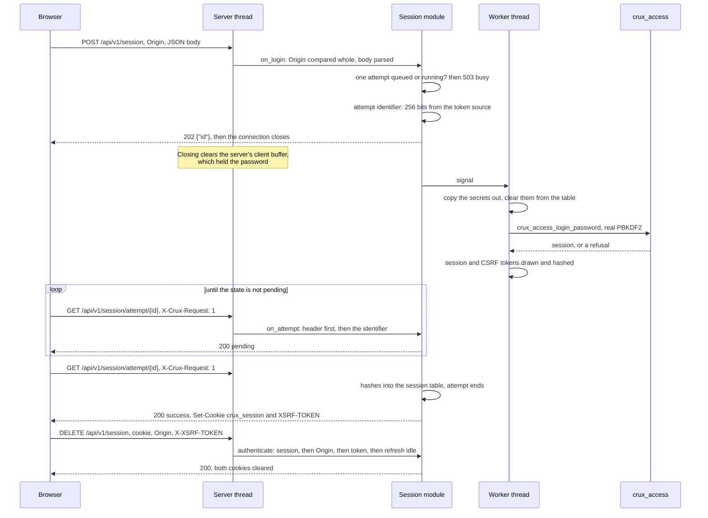
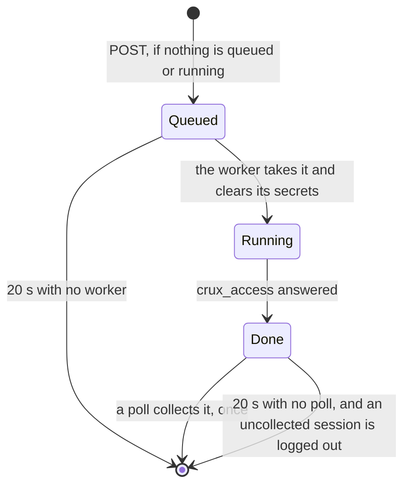
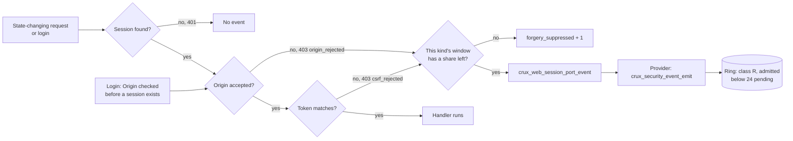

# Web login, sessions and request forgery protection

Status: merged in [PR #278](https://github.com/wonny-labs/crux-pilot/pull/278) for Issue #186. Nothing here has run on a board. #186's own test image uses plain HTTP, and the sessions have since run over HTTPS on both TLS profiles in [the services image](native-composition-242.md) and in the [browser runs of #220](e2e-native-220.md). Host and `native_sim` results are interim results, and physical evidence stays tracked apart.

Owner: `components/web`. The settings type, the start calls and the authentication function are public in `<crux/web_session.h>` (target `crux::web_session`, ADR-0004 phase 1a, Experimental). The rest, the counters and token sizes, is in the internal header `components/web/session/crux_web_session.h`, for a composition only, like
`crux_web_adapter.h`. Sources in `components/web/session/`, listed by `sources.cmake`. Ports on PSA Crypto in
`components/web/ports/psa/web_session_psa.c`.

## What is built, faked and untested

| Part | State | Evidence |
| --- | --- | --- |
| `crux_web_authenticate_t` over `crux_access`: cookie, session table, `Origin`, CSRF token, idle refresh | **Built** | Host on the real Web and Access cores. `native_sim` on the real Access core and its real PSA ports. |
| Security events for a refused CSRF token and a refused `Origin`, from the session layer, at most 3 per kind in 60 s | **Built**, [below](#security-events-for-a-refused-csrf-token-or-origin) | Host on the real session core with a fake event port, and the provider on the recording fake of the event contract. `native_sim` and the target have not run it. |
| Two-request login through one bounded worker (decision D10) | **Built** | Host, with a real worker thread. `native_sim`, with real PBKDF2. |
| Session routes: login, attempt poll, logout, current user, own password change | **Built** | Host and `native_sim` |
| Random and hash ports on PSA Crypto, refusing to build for a board with a known test generator (see the limit below) | **Built** | `native_sim` on TF-PSA-Crypto. RT1060: compile only, in CI. |
| Entropy on `native_sim` | **Test-only**, `fake_entropy_native_sim`. **A token's strength is not shown anywhere here.** | |
| Fake random and hash ports | **Faked on Host only**, in `tests/web/session/session_test.c`: distinct bytes and an FNV hash, neither cryptographic | |
| Fake transport | Host only, from `tests/web` | |
| Idle and absolute expiry | Host only. The limits are 15 minutes and 8 hours in the composition, too long for a `native_sim` run. | |
| HTTPS | **Not in #186's own image**: plain HTTP on loopback. Over HTTPS: [HTTPS composition](https-composition.md) and [the services image](native-composition-242.md). | |
| Header capture on Safari | **Not run.** Safari cannot run unattended on this machine. The criterion stays open. A by-hand observation of the `Secure` cookie on the mock is under decision 14. | |
| RT1060 | Compiled as objects in CI. Linked in the Mbed management image (`samples/management_rt1060_mbed`), which `psa-crypto.yml` cross-builds on each pull request and push to `main`, and in the bench image (`tests/zephyr/management_rt1060_compile`, one local cross-build), which refuses to start. Neither has run on a board | |
| Anything on a board | Not run. No hardware was operated. | |

## How a login flows

## Rules

| Rule | How it holds | Shown by |
| --- | --- | --- |
| The server thread never verifies a password | Login and a password change only queue. The worker runs `crux_access`, outside every lock. | `concurrency.c`: a verification held open, up to 10 s, until 250 other requests have been answered, the slowest round of five in 1 ms here against an allowance of 1,000 ms |
| One verification at a time | One attempt queued or running. Another `POST` gets `503 busy` with `Retry-After`. | `login.c` busy case |
| Attempt identifiers of at least 128 bits, from the session token source | 256 bits, one draw from `crux_web_session_port_random`, the same function that draws session and CSRF tokens | `login.c` compares the identifier and the CSRF token with the port's last draw |
| The poll requires `X-Crux-Request: 1` | Checked before the identifier is read. Without it: `403 csrf_rejected`, no cookie, attempt unchanged. | `login.c` and `native_sim`, before and after the worker finishes |
| Session token stored as a hash | SHA-256 of the 43-character token. The CSRF token is stored as a hash too. Every slot is compared, so time does not say which matched. | Host |
| Cookies | `crux_session=<token>; Secure; HttpOnly; SameSite=Strict; Path=/` and `XSRF-TOKEN=<token>; Secure; SameSite=Strict; Path=/`, with no persistent expiry | Byte for byte, Host and `native_sim` |
| CSRF token holds no `%` and no quotes | Unpadded base64url, `A-Z a-z 0-9 - _` | Host and `native_sim` |
| CSRF token independent of the session token | A separate draw | Host and `native_sim` |
| State-changing requests need the token and `Origin` | Any method but `GET`. Session first, so no session is `401`. Then `Origin`, then the token. | `sessions.c` on `POST`, `PUT`, `DELETE`, `PATCH`, and `native_sim` |
| `Origin` on login | Checked before the body is read, and before anything is drawn or queued | `login.c` with 15 wrong forms, and `native_sim` |
| Accepted `Origin` | The scheme, `://` and the request's own `Host`, compared whole and exactly, with `Host` limited to name and address characters. A composition may give an exact list instead. | `sessions.c` |
| Idle and absolute expiry | `crux_access` holds both limits. State-changing requests call `crux_access_touch`, and `GET` does not. | `sessions.c` on the fake clock |
| A password or role change ends sessions | `crux_access` ends the account's sessions. The next lookup finds the session invalid, clears its slot and answers `401`. A disable and an administrator's reset do the same. | `sessions.c`, and `native_sim` for one's own change |
| Replies do not reveal whether a user exists | Every login is queued and answers `202`. Every rejection polls as `{"state":"rejected"}` with the same headers: wrong password, unknown name, disabled account, a name outside the rules, a name holding a NUL, a password over 128 bytes, and an unusable store | `login.c` and `native_sim`, byte for byte |
| Security headers | The core's: CSP, `nosniff`, `no-referrer`, `no-store`. **No HSTS**, and no CORS header. | `sessions.c` on every session route, and `native_sim` |

## Security events for a refused CSRF token or Origin

Decided by the owner on 2026-11-14 on [Issue #319](https://github.com/wonny-labs/crux-pilot/issues/319): emit an event for a refused CSRF token and for a refused `Origin`, from the session layer, rate-limited so that a flood cannot fill the event ring.

| Refusal | Where it is decided | Event | Result | Fields |
| --- | --- | --- | --- | --- |
| `403 origin_rejected` on a request that has a session, any method but `GET` | `crux_web_session_authenticate` | `web.origin_rejected`, **new**, 0x0605, class R, Experimental | `DENIED` | channel 2, the peer's address, the session's account |
| `403 csrf_rejected` on a request that has a session and an accepted `Origin` | `crux_web_session_authenticate` | `web.csrf_rejected`, 0x0601, class R, defined before and now emitted | `DENIED` | The same |
| `403 origin_rejected` on a login | `on_login` in `web_session_routes.c`, before the body is read | `web.origin_rejected` | `DENIED` | channel 2, the peer's address, **no user**: there is no session yet |

| Not reported | Why |
| --- | --- |
| A request with no session, a forged cookie or an ended session: `401` | `401` says nothing about a token or an `Origin`, and the check order puts the session first. A forgery against a visitor with no session leaves nothing to protect, and a probe of cookies is not this signal. |
| `GET` with a wrong `Origin` or no token | Neither is checked on `GET`. |
| A poll without `X-Crux-Request: 1`, which answers `403 csrf_rejected` | It is not the CSRF token, the issue names the token and `Origin`, and the attempt identifier is 256 bits. See decision 19. |

A report holds the kind, the web channel, the peer's address as the web adapter gave it, and, when a session was found, the account name from `crux_access_session_user`. It has no `Origin`, no header text, no token and no subject, and the event's `subject` is empty. The event contract's rule that client input failing validation is never a field holds by construction: the report has no field that could carry it. `events.c` hostile-string case searches every report for the `Origin`, the token and the login's user name that the client sent, and for the session's own tokens.

### The bound

| Layer | Bound |
| --- | --- |
| The contract's admission | A class R record is admitted only below 24 pending of 32, and the drain pauses 100 ms after every 4 lines. Alone, that lets a flood hold the ring at 24 for as long as it lasts, and every other class R record (`access.login_failed`, for one) is dropped meanwhile. It stops the flood from reaching the change reserve and nothing more. |
| The session layer's window | **Added here**, small, and private to the module. Per kind, a fixed window of `CRUX_WEB_SESSION_FORGERY_WINDOW_MS` (60 s, by the web clock) reports at most `CRUX_WEB_SESSION_FORGERY_EVENTS` (3) refusals. The window starts at the first refusal it reports. The later ones in that window count in `crux_web_session_stats_t.forgery_suppressed`, and send no report. |
| What that gives | At most 3 records of each kind in a window, so 6, and 12 across the edge of two windows. That is half of the 24 that the default ring admits as routine, with the other half for other emitters, and a sustained flood adds 6 a minute. A refusal past the share reaches neither the user lookup, the provider nor the ring, so it does not pay the ring lock's wait (up to 10 ms). It does take the attempt lock once, to count itself in `forgery_suppressed`, and waits for it up to `CRUX_WEB_SESSION_LOCK_WAIT_MS` (20 ms) as the other counters do. That wait is the same bound that a poll already accepts, and the worker holds the lock only to copy. A product with a smaller ring sets the two macros lower. |
| Why not only the contract's admission | The issue asked that a flood not fill the ring, and the contract has no per-identifier rate rule to follow. Without a window, a flood of refused requests hides every other routine record. |
| What it costs | A flood is visible as 6 records a minute and a counter, and the count of refusals past the share is not in the event log, only in the counter, which nothing reads yet: no status item or route exposes `forgery_suppressed`. |

Both windows are state of the server thread, reset by `crux_web_session_init`. `web_session_attempts_reset` also zeroes the counter.

### The provider

`components/web/session/web_session_security_events.c` translates a report onto `crux_security_event_emit`, as the other event providers do, and holds no state. An image that links the session module with the real events lists it (the native management composition, the RT1060 bench image's lists, the module's session library under `CONFIG_CRUX_WEB_SESSION`, which needs `CONFIG_CRUX_ACCESS` and so the events, and `tests/native/web_session`). The Host suites compile a fake port in `session_test.c` in its place. `tests/zephyr/web_compile` compiles the provider for the target and does not link it. A report of a type that the provider does not map is recorded as `event.unknown` with the result `FAILED`, never as a success.

| Property | Rule here |
| --- | --- |
| A NUL in a header value ends the captured value | Every check compares a whole expected value with the whole captured one, by length and content: the cookie's token, the CSRF token, `Origin` and `X-Crux-Request`. A captured prefix of a token never passes. On `native_sim` a token cut by a NUL got `403`. |
| An empty duplicate header evades the duplicate check | An empty value reads as no header, and every check needs a value. An empty duplicate beside the right value changes nothing, and alone it is refused. Both shown on `native_sim`. |
| A NUL after a correct value | `X-Crux-Request: 1` followed by a NUL and more is captured as `1` and passes. Only a client that is not a browser can send it, and such a client can send `1` anyway, so it gains nothing. |
| The password stays in the server's `client->buffer` | **Login and a password change close the connection after every response**, including refusals. Zephyr's `http_server_release_client` then clears the whole client context, with its buffer and capture, at v4.4.2. The core clears its body copy, the handlers clear their buffers, the worker clears the attempt's copy when it takes it and its own copy after verifying. Host tests check that a marker password is in neither the core's body nor the handlers' buffers after the `POST`, and not in the attempt table after the worker. The worker's own copy is on its stack, which no test can see. A refusal by the access check after a body that came in more than one read also closes, shown by `sessions.c`. |
| What stays in RAM | Copies outside Crux: the host or Zephyr TCP buffers, and with #185 the TLS record buffers. A session token also passes through every request's capture buffer and the shared response store, until each is overwritten. The table holds hashes only. |

## Bounds

| Macro | Default | Why |
| --- | --- | --- |
| `CRUX_WEB_SESSION_MAX` | 8 | No more can be live than `crux_access` holds. An ended session's slot is reused. A full table answers the poll `503 busy` and logs the new session out. |
| `CRUX_WEB_SESSION_ATTEMPTS` | 4 | One queued or running, the rest waiting for their poll. A full table refuses with `503` rather than drop a result. |
| `CRUX_WEB_SESSION_ATTEMPT_TTL_MS` | 20,000 | "Attempts expire quickly" |
| `CRUX_WEB_SESSION_LOCK_WAIT_MS` | 20 | The server thread's longest wait for the attempt lock. The worker holds it only to copy. |
| Login and password change body | `CRUX_WEB_BODY_BUFFER`, 1 KiB | A 128-byte password of control characters is 768 bytes once escaped |

RAM: the attempt table is about 2.3 KiB and the session table about 0.6 KiB at the defaults, and the handlers keep 1.3 KiB
of static buffers for the server thread. The worker uses the `crux_thread` default stack, 8 KiB in the composition, which
was not measured: `native_sim` threads run on host stacks.

## The stall that work on the worker causes

The design moved verification to a worker so that it would not stall the server thread. It still can, and this is the
declared limit.

| Platform | What happens during one verification | Source |
| --- | --- | --- |
| `native_sim` | A thread that computes is never preempted, so the server thread waits for the whole attempt | Measured for failed logins, below |
| A target, by the source, not run | The HTTP server thread runs at the lowest preemptive priority, `K_PRIO_PREEMPT(CONFIG_NUM_PREEMPT_PRIORITIES - 1)`, and `crux_thread` priorities map to 6, 5 and 4. That is `K_LOWEST_APPLICATION_THREAD_PRIO`, so no thread can run below it. The worker, at `LOW` and at the default of `CONFIG_CRUX_WEB_SESSION_WORKER_PRIORITY` ([Priority map of Crux threads](thread-sync.md#priority-map-of-crux-threads)), preempts the server thread for the whole attempt too. With `NET_TC_THREAD_COOPERATIVE` the server thread is cooperative and would preempt the worker instead. | Zephyr v4.4.2 `http_server_core.c`, `components/thread/ports/zephyr/thread_native.c` |

**Declared limit: another client waits at most one attempt's work on the worker, plus the requests ahead of it.** An
attempt is one of these:

| Attempt | Work on the worker |
| --- | --- |
| A failed login, or one inside a delay window | One derivation, `T_v`, or none |
| A successful login | One derivation, and two token draws and hashes |
| A successful login whose stored verifier has a lower cost, which `crux_access` upgrades | Two derivations and a save to the credential store |
| A password change | Two derivations, the current password and the new verifier, and a save |

Only one attempt runs at a time, and after each the worker waits for the next `POST`, which the server thread must
handle, so the server thread runs between any two. `T_v` and the save on a target are unmeasured, and
`CRUX_ACCESS_VERIFIER_ITERATIONS` is still the 10,000 placeholder, so #197 should measure them with the web stall in mind.
Changes that could shorten the stall, none taken here:

| Change | Effect | Cost |
| --- | --- | --- |
| The worker at the server thread's priority, with `CONFIG_TIMESLICING` | The two share the processor in slices, so the server thread waits one slice and not a whole attempt | A priority `crux_thread` does not offer, so a Zephyr-specific worker or a new option |
| `NET_TC_THREAD_COOPERATIVE` | The server thread becomes cooperative and preempts the worker | A system-wide networking setting, and the server thread then holds the processor whenever it runs |
| The derivation split into chunks that yield | The server thread runs between chunks | A change to the Access derive port, which derives in one call on PSA |

| `native_sim` measurement, two clients sending failed logins for 60 rounds of another client's `GET /api/v1/session/me` | Result |
| --- | --- |
| The other client, before: median and largest wait | 9 ms and 17 ms |
| The other client, during: median and largest wait | 10 ms and 86 ms, every request answered `200` |
| Failed logins by the two clients | 6 verified and rejected, 20 refused as `429` inside the delay window, none busy |
| Longest whole failed attempt seen by a client, `POST` to result | 0.399 s |
| Bound checked | largest wait during at most largest before, plus the longest whole failed attempt seen by a client, plus 1.5 s for the emulated container |
| The worker's own counter, `worker_max_ms` | 0: the simulated clock does not count computing, as the composition records, so the bound uses the client's measure |

## Tests

| Command | Level | Covers |
| --- | --- | --- |
| `scripts/test-web-session.sh host` | Host | The four suites, `host-sanitize` when the toolchain has its runtime, clang-tidy, both review lists |
| `scripts/test-web.sh host` | Host, CI | The same suites, under debug and sanitizers, with the existing web checks |
| `scripts/test-web-session.sh native` | `native_sim`, CI in the PSA workflow | `tests/native/web_session`, Mbed profile, and `test_driver.py` as a real client |
| `scripts/test-web.sh target mbedtls` | RT1060 compile, CI in the PSA workflow | The session module and its PSA ports compile for the target, as five objects |

| Host suite | Covers |
| --- | --- |
| `login.c` | The two requests, cookie attributes, the token source, the poll header, unknown and malformed identifiers, identical rejections, the delay window as `429`, busy and full tables, expiry and the logout of an uncollected session, `Origin` on login, body rules, the password not staying, random failures, a full session table and the clearing of ended sessions from it |
| `sessions.c` | Missing and forged sessions, including a prefix, a changed character, quotes, percent encoding, a near name and a duplicate; the forgery rules on every method; a configured `Origin` list; wrong role and a forced change; idle and absolute expiry; role change, reset and disable; one's own password change with each result, a `429`, a refusal after a two-part body that closes, and an expired change that leaves its session; logout; security headers; a failing hash |
| `events.c` | The reports to a fake port: each refused token form, each refused `Origin` form, a login's `Origin`, none for accepted requests, `GET`, no session, a forged cookie and a wrong password, the bound under 100 requests of each kind with its counter, the window's two edges, a new share after `crux_web_session_init`, no client text in any report, and the fields of a report: an address that fits no buffer, no session and an ended one |
| `events_provider.c` | The provider on the recording fake of the event contract: each type to its identifier, result `DENIED`, channel, address and user, no subject, no field omitted for being out of rule, and an unmapped type as `event.unknown` |
| `json.c` | The bounded reader: escapes, surrogate pairs, NUL, overflow, and 31 malformed bodies |
| `concurrency.c` | The real worker thread: a verification held open while other requests are answered, and 40 failed logins beside another client |

| `native_sim` case, on the real Access core, PBKDF2 and store | Result |
| --- | --- |
| Two-request login, cookies byte for byte, a result collected once, the current user | Pass |
| Poll without the header, or with `0`, `11`, `true`: `403`, no cookie, then collected | Pass |
| Missing, forged, prefix and swapped tokens: `401` | Pass |
| Wrong role: `403 permission_denied` | Pass |
| Missing and short CSRF token, missing, wrong and extended `Origin`, login with a wrong or no `Origin` | Pass |
| Empty duplicate headers, and a token cut by a NUL | Pass, as declared above |
| Own password change: queued and closed, success with no cookie, the other session ended | Pass |
| Logout clears both cookies and ends the session | Pass |
| Wrong password, unknown name and bad name give identical poll responses | Pass |
| Failed logins beside another client | Pass, within the bound |
| The random, hash, derive and login functions come from their real sources in the image | Checked with `nm -l` |

| Mutation, each tried once on Host | Caught by |
| --- | --- |
| The poll ignores `X-Crux-Request` | 37 checks in `login.c` |
| The poll checks the header only after collecting the attempt | 34 in `login.c` |
| The CSRF token is not compared | 17 in `sessions.c` |
| `Origin` is not checked on session routes | 33 in `sessions.c` |
| `Origin` matches by prefix | 8 in `login.c`, 9 in `sessions.c` |
| Login does not close the connection | 18 in `login.c` |
| `GET` refreshes the idle timer | 3 in `sessions.c` |
| A duplicate session cookie is accepted | 4 in `sessions.c` |
| A session `crux_access` ended stays in the table | 1 in `sessions.c` |
| The worker leaves the password in the attempt | 1 in `login.c` |
| The handlers do not clear their buffers | 1 in `login.c` |
| The table keeps ended sessions when a slot is needed | 1 in `login.c` |
| The `Origin` list matches by prefix | 4 in `sessions.c` |
| A refusal at the access re-check keeps the connection | 1 in `sessions.c` |
| An expired change logs out its requester | 2 in `sessions.c` |
| No window: every refusal is reported | 9 in `events.c` |
| Both kinds share one window | 5 in `events.c` |
| A login's `Origin` is not reported | 3 in `events.c` |
| The session's user is not looked up | 12 in `events.c` |
| A refused token is reported as an `Origin` refusal | 13 in `events.c` |
| The window never restarts | 6 in `events.c` |
| The suppressed count is not kept | 2 in `events.c` |
| A longer cookie value is accepted | **Not caught**, because the token's form check refuses it as well. Both checks stay. |

## Results

Local runs in container `crux-186`, image `crux-pilot-devcontainer:local` under amd64 emulation, Zephyr v4.4.2 with
TF-PSA-Crypto `dc575a2` and Mbed TLS `a3e190f`. CI results are in the pull request.

| Check | Level | Result |
| --- | --- | --- |
| `Web.*`, seven suites, three of them from #184, debug preset | Host | Pass |
| `host-sanitize` | Host | **Not run locally**: the container's clang has no ASan runtime. CI's host workflow runs it. |
| clang-tidy on the session and core sources and suites | Host | No finding |
| `scripts/check-format.sh`, `scripts/check-web-boundary.py`, the generator's tests, both review lists | Host | Pass |
| `scripts/test-web-session.sh native`, twice | `native_sim/native/64`, Mbed profile | Pass, every case. A login took 0.315 s from `POST` to success, and a password change 0.303 s, polling every 50 ms. |
| RT1060 compile | Target compile | **Not run locally**: this workspace has no NXP HAL. CI's PSA workflow runs `scripts/test-web.sh target mbedtls`. |

## What is not verified

- Safari. Header capture on Safari was not run, as `docs/web-contract.md` records. The one Safari observation is by hand, on the mock only: decision 14. Firmware over HTTPS in Safari was not run.
- `Origin` and `Host` on a real address with HTTPS in a browser. HTTPS itself ran in #185 and #242 with a test client and Chrome, not on a real address.
- Token strength: the entropy on `native_sim` is test-only.
- Idle and absolute expiry on `native_sim`, and anything on Zephyr's own TCP stack.
- The worker's stack, the verifier's and the save's time on a target, and the stall they cause. The stall of a password change or a cost upgrade is declared above and not measured.
- The PSA ports' guard is a deny-list of `CONFIG_FAKE_ENTROPY_NATIVE_SIM` and `CONFIG_TEST_RANDOM_GENERATOR`. Where those Kconfig macros are not visible to the file, as in a build without Zephyr's `autoconf.h`, or with another test generator, it passes silently.
- The Wolf profile in #186's own `native_sim` image: only the Mbed profile runs there. Both profiles ran the sessions over HTTPS later, in [the services image](native-composition-242.md).
- The refusal events on `native_sim` and on a target: only Host ran them, on a fake port and on the recording fake of the event contract. The real ring, the drain and the real provider with the real session core are not run together anywhere. The window's bound is shown at the port, and its effect on the ring follows from the contract's numbers.
- The ring's behaviour under a refusal flood with other class R records waiting, which a run with the real core would show.
- Whether 3 records in 60 s per kind is the right share for a product. It is a default.

## Decisions taken without an answer

| # | Decision | Narrower choice | Alternative |
| --- | --- | --- | --- |
| 1 | `POST /api/v1/session/me/password` is implemented here | It shares the worker, the attempt and the poll, which the specification defines in the session tag, so #187 need not reach into them | Leave it to #187 |
| 2 | One attempt queued or running at a time, and a full table refuses | No result a client is polling for is dropped. **Declared:** four uncollected results hold every slot for 20 s, so one unauthenticated client sending a `POST` every 5 s keeps every login at `503`. The serial console is not affected. | A queue, evicting the oldest result, or a cap on held attempts per source |
| 3 | A `crux_session` cookie that appears twice is no session, an empty one included, as in `crux_session=TOKEN; crux_session=` | A tossed cookie can deny, but cannot choose the session | Try each |
| 4 | `Origin` must be the scheme and the request's own `Host`, unless a list is given | No configuration needed for a device without a fixed name. A DNS rebinding page has matching `Origin` and `Host`, but the `SameSite=Strict` cookies of the device's name are not sent to it, and with #185 the certificate does not match. A product with a fixed name should give the list. | Require the list |
| 5 | Plain `http` is refused unless the build defines `CRUX_WEB_SESSION_PLAIN_HTTP_FOR_TESTS`, which fails to compile on any board but `native_sim` | Only the `native_sim` test image defines it | A runtime setting only |
| 6 | Tokens and identifiers are 256 bits, hashed with unkeyed SHA-256 | A token of 256 bits needs no key | HMAC with a boot key |
| 7 | Login and a password change close the connection after every response | The server then clears its copy of the password. A poll costs a new connection, and with #185 a new handshake. | Keep the connection and declare the copy |
| 8 | A poll that cannot take the lock in 20 ms answers `pending` | Leaves the attempt as it was. `503` would tell the client that it ended. | `503` |
| 9 | Order of checks: session, then `Origin`, then token, then the idle refresh | `401` says nothing about a token. A denied permission after a valid token still refreshes the idle timer, since the user acted. | Refresh only after the access class |
| 10 | A success nobody collects is logged out after 20 s | An abandoned session does not wait for the idle limit | Leave it to the idle limit, as the specification allows |
| 11 | The request head gains the peer's address, IPv6 as its /64 prefix, an IPv4-mapped IPv6 address as its IPv4 address, and an unknown peer has none, which shares one delay bucket | `crux_access` needs a source for its delays. The IPv6 branches are compiled only where IPv6 is on, and no test image has it, so they are untested. | |
| 12 | `crux_web_close_after_response()` is added to the adapter header | Three lines in the core, and the adapter's existing close path | |
| 13 | The logout response is `200` with an empty `text/plain` body | The specification says not to parse it as JSON | `application/json` with no body |
| 14 | `Secure` is set in the plain HTTP test image too | The cookie lines are those of a product. Chromium 152 and Firefox 159 kept the cookie over `http://localhost` in the header captures of [the web contract](web-contract.md#header-capture). **Safari did not**: observed on 2026-11-08, by hand, on the mock server of the web examples only. Firmware over HTTPS in Safari was not run. | Drop it in the test image |
| 15 | The `native_sim` image uses `CONFIG_MINIMAL_LIBC`, as `tests/native/web_http` does, for Zephyr's `fnmatch` | Upstream sources warn of implicit declarations under it, as in that image | Picolibc |
| 16 | RT1060: compiled as objects, not linked | A link needs the Access core's store and events, which only a product composition brings | Stub ports in a compile test |
| 17 | Refusals are reported through a port with a provider, not by a direct call of `crux_security_event_emit` | The same shape as every other emitter, so the session module links no event header, and a Host test records what the module reported, with a controlled clock | A direct call |
| 18 | A window of 3 reports per kind in 60 s, fixed and global per kind, not per source | The smallest bound that keeps the ring's routine share. A per-source bound needs a table, and a flood from many sources would pass it. Two windows at the edge allow 6 per kind. | A token bucket, a per-source table, or a summary record with the suppressed count |
| 19 | The poll's missing `X-Crux-Request` is not reported, though it answers `csrf_rejected` | The decision names the token and `Origin`, and this check has no token. A probe that guesses an attempt identifier is not the forgery these events are for. **Recommended for the owner:** leave it, or add a report of the same kind in `on_attempt` with the same window if the response code is to match the event. | Report it as `web.csrf_rejected` |
| 20 | The account of the session is recorded, when there is one | It is a name that the server issued, and it says whose session a forgery was aimed at. A login's `Origin` check has none. | No user |
| 21 | `web.origin_rejected` is 0x0605, class R, Experimental | The next free value in the web range. Class R, as `web.csrf_rejected` is. The component is Experimental as a whole. | A change-class record, which the reserve would then admit during a flood |

## What a route that needs a session can rely on

Written for #187, whose routes now use it. [The product guide](management-in-a-product.md#routes) says what a frontend must send.

| Item | Where |
| --- | --- |
| The session lookup for its routes | Compose `crux_web_session_authenticate` and name `web_session_routes.c` to `crux_web_routes`, as `tests/native/web_session` does |
| Session-only routes get `Origin`, the CSRF token and the idle refresh for free on any method but `GET` | `crux_web_session_authenticate` |
| A handler checks its own permissions with the session it is given | Unchanged from #184 |
| The password change exists, at `POST /api/v1/session/me/password`, so no other route adds one | `web_session_routes.c` |
| An account change that ends sessions needs nothing more here: the next lookup answers `401` | `sessions.c` shows it |
| Slow work goes to a worker, and the web stall above applies to any worker at a `crux_thread` priority, which is always above the server thread's | This document |
