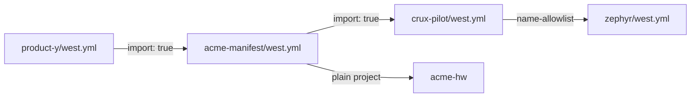

# Organisation manifest template

A starting point for the optional organisation layer of the [Product Composition Guide](../../docs/product-composition.md#structure): one manifest repository that the products of one organisation import instead of importing Crux directly. Everything here is fictional: the organisation `acme`, its host `git.example`, the products `product-x` and `product-y`, and the shared hardware module `acme-hw`.

Where boards and drivers go, and when one moves into the shared module, is in [Shared boards and drivers across products](../../docs/shared-hardware-modules.md). The module itself has a template in [`templates/hardware-module/`](../hardware-module/README.md).

| File | Purpose |
| --- | --- |
| `west.yml` | The organisation manifest, `acme-manifest`. It imports `crux-pilot` and pins the shared hardware module `acme-hw` |
| `product-y/west.yml` | A product manifest that imports `acme-manifest` in place of `crux-pilot` |

## When to introduce the layer

Start without it. A single product imports Crux directly, as the [product template](../product/README.md) does, and keeps its own boards and drivers.

Introduce the organisation manifest when two or more products share a composition: the same Crux revision, the same fork or vendor repository, or the same boards and drivers. It then holds those shared pins once, so that the products move together. It costs one more repository, one more pin to move in each product, and an owner for that repository.

Keep in a product manifest what only that product uses.

## How west resolves the three manifests

The product repository stays the manifest repository (west's T2 topology). Its `west.yml` imports `acme-manifest`, which imports `crux-pilot`, which imports Zephyr with Crux's module allowlist.



- **The first definition wins.** West reads the product's own entries first, then the organisation's, then Crux's, then Zephyr's. A project entry in `product-y/west.yml` beats one of the same name in `acme-manifest`, and an entry in `acme-manifest` beats Crux's. So the organisation can override a Crux pin for all products, and one product can override the organisation.
- **Filters narrow an import.** `import: name-allowlist: [...]` on an import keeps only the named projects, and `import: name-blocklist: [...]` drops the named ones. Both apply to every project that the import brings, including those it imports in turn. A filter cannot add a project that the imported manifest left out. Crux's own Zephyr allowlist still applies under any filter.

  ```yaml
      - name: acme-manifest
        remote: acme
        revision: <tag or SHA>
        import:
          name-blocklist: [acme-hw]
  ```

  The hardware module's [CI manifest](../hardware-module/ci/west.yml) uses exactly this, so that the module under test is the checkout of its own repository and not the copy that `acme-manifest` pins.
- **Overrides keep their reason.** An entry in `acme-manifest` that replaces a project Crux pins carries `userdata: crux-override: "<reason>"`. The userdata travels with the project through the import, so `west crux-pins` in each product prints `OVERRIDE` with that reason. Without a reason it prints `MISMATCH` and fails. The fork must contain the commit that Crux pins. See [Soft forks](../../docs/product-composition.md#soft-forks).
- **Groups.** Crux's optional groups (`crux-secure-management`, `crux-reliance`, `crux-boot`) are off by default. West combines the `group-filter` of every manifest in the chain, and the importing manifest wins: the product's filter beats the organisation's, which beats Crux's. Enable a group in the organisation manifest only when every product needs it, and otherwise in the product. Check the licence of each group first: see [Commercial editions](../../docs/product-composition.md#commercial-editions).

## What `west crux-pins` reports

`west crux-pins` compares the workspace with the Crux contract only: Crux's `west.yml` at the pinned revision, plus Zephyr's at Crux's Zephyr pin. It reads the Crux project wherever it is in the import chain.

| Project | Report |
| --- | --- |
| `crux-pilot` | `CONTRACT` |
| Zephyr and the allowlisted modules, as Crux pins them | `OK` |
| `acme-manifest` itself, and `acme-hw` | `PRODUCT` |
| A Crux pin replaced in `acme-manifest` with `crux-override` | `OVERRIDE` with the organisation's reason |
| A Crux pin replaced in `acme-manifest` without a reason | `MISMATCH`, and the command fails |

It does not compare a product with its organisation manifest. A product that pins `acme-hw` at another revision still sees `PRODUCT` and passes. If the organisation needs that check, it is an organisation tool, for example a comparison of `west manifest --resolve` of the product with the organisation's pins.

## Start the layer

1. Create the `acme-manifest` repository from `west.yml`, replace `acme` and `git.example`, and pin `crux-pilot` and `acme-hw`.
2. In each product, replace the `crux-pilot` entry with the `acme-manifest` entry of `product-y/west.yml`, and remove what `acme-manifest` now pins.
3. Run `west update` and `west crux-pins` in each product, and compare the result with the table above.
4. For a release, pin `acme-manifest` by tag or SHA in the product and freeze as the [release flow](../../docs/product-composition.md#release) says. The lock lists every project, `acme-manifest` and `acme-hw` included, so the release does not depend on the organisation manifest's later state.
